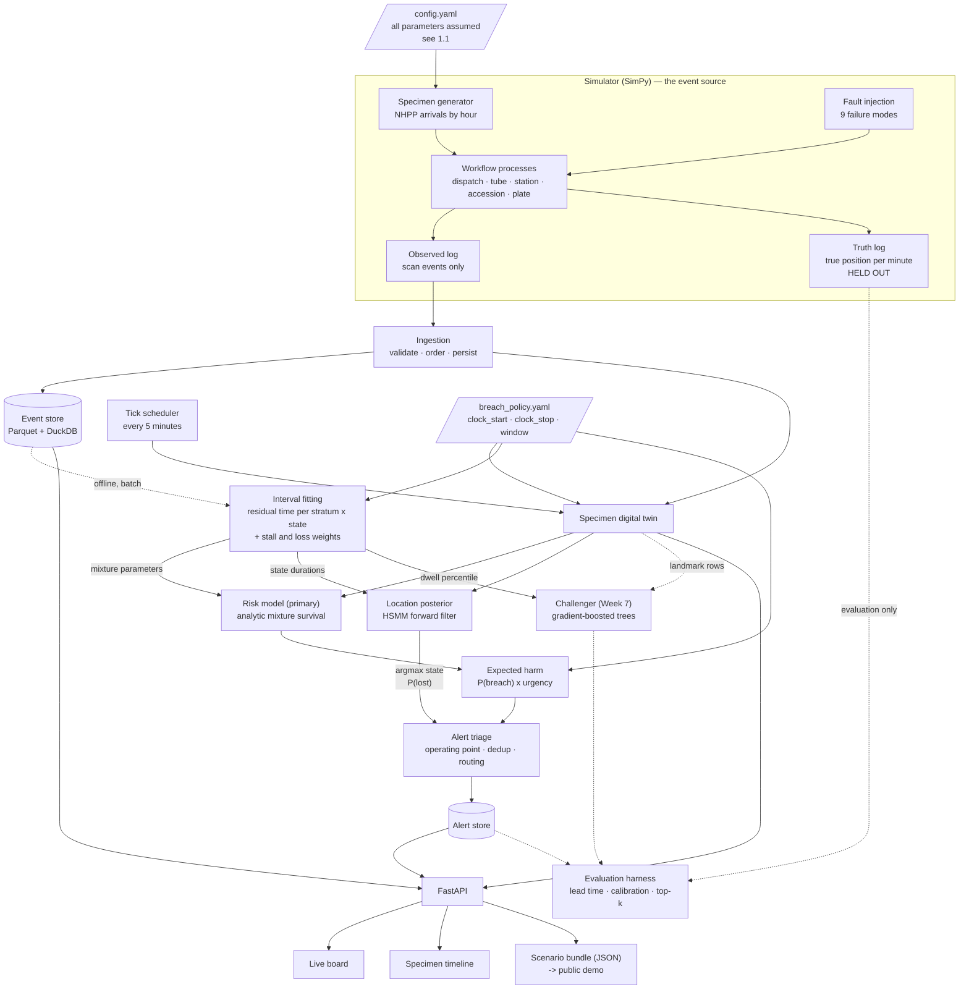

# Tracer — AI Solution Architecture

**Course:** CAI 5724, AI in Health Design Studio I
**Milestone:** Week 4 — AI solution architecture (5% of project grade), due Wednesday September 16, 5 PM
**Team:** Daniel Escalante (engineering), Karissa Kocourek (clinical microbiology)

This document specifies what gets built. It expands §7 of `project-spec.md` into a buildable design and
supersedes it where the two disagree; the divergences are listed in §12.

---

## 1. What the system has to do

A specimen is collected at a patient's side and scanned. It travels to the laboratory. It is scanned again
on receipt. Between those two scans there is no record of any kind. If the specimen never arrives, nothing
in the laboratory fires, because every monitoring mechanism in the workflow is triggered by an event, and
the failure that matters most produces no event at all.

Tracer therefore has to do something no event-driven system does: **treat the passage of time as evidence.**
Every few minutes it re-examines each specimen that has not yet completed, asks how unusual that silence is
for this kind of specimen from this unit at this hour, and converts the answer into a probability that the
specimen misses its clinically relevant window. When that probability crosses an operating point chosen by
alert burden, it raises one alert, names the most likely place to look, and routes it to the role that can
act.

Three things follow, and they shape every decision below:

1. **The unit of work is a clock tick, not an event.** The pipeline has a scheduler that re-scores
   outstanding specimens on a fixed cadence. An architecture that only reacts to arriving events cannot
   detect absence.
2. **The target variable does not exist without clinical input.** A raw interval is not a breach until a
   window says so, and until someone says which two events the window runs between. See §10.
3. **Lead time is the headline metric, not accuracy.** A perfectly accurate alert that fires after the
   window has closed has failed. Evaluation is designed around minutes of warning at a tolerable alert
   volume.

## 1.1 The event source, and what real data can and cannot fix

**The simulator is the event source.** Every event the system ingests, trains on and is evaluated against
comes from the project's own discrete-event model.

This is not a preference. The digital twin needs five or six observable states to be worth building, and no
public dataset has them. MIMIC-IV's `microbiologyevents` records `charttime` (collection) and `storetime`
(the final result as documented) and nothing between: no receipt, no accessioning, no plating, no transport
record, and the paper states directly that intermediate results are not captured. For cultures the
collection-to-result gap spans days and includes incubation, so it is not even the same quantity as the
transit interval this project is about. The unobserved interval is unobserved there too, and wider.

**Calibration against real data was tested and rejected.** An earlier version of this design proposed using
the MIMIC-IV Clinical Database Demo (100 patients, open access, Open Data Commons Open Database License) to
calibrate two simulator parameters: specimen-type mix and the collection time-of-day profile. The extract
was obtained and checked before any calibration code was written. **Neither parameter survived the check.**
Full working in `docs/mimic-demo-findings.md`, reproducible via
`notebooks/mimic_demo_calibration_check.ipynb`. The measured grounds:

| Parameter | Sample size | Population | Decision |
|---|---|---|---|
| Specimen-type mix | **Fail.** 1,336 specimens across 35 types; 27 types have n < 30 and 18 have n < 10 | **Fail.** Blood culture is 38.3% of the extract and is excluded from this prototype; CSF has 8 specimens; `URINE` carries no container field, so the preserved/unpreserved pair that the policy table exists to express is invisible | Revert to assumed |
| Collection time-of-day | **Pass.** 1,291 specimens with `charttime`, all 24 hours populated, minimum 20 per hour | **Fail.** 19.6% of collections fall between midnight and 06:00, and the largest blood-culture hour in the extract is 06:00 — the signature of inpatient pre-dawn draw rounds | Revert to assumed |

The population objection is the decisive one. All 100 patients in the extract had an ICU stay and 48.7% of
admissions arrived through the emergency room; this is Beth Israel Deaconess critical care data. Tracer's
target setting is a general clinical microbiology laboratory serving inpatient, emergency **and outpatient**
collection, whose specimen mix is characteristically heavy in outpatient urine and whose overnight
collection volume is close to nil. Importing this hourly curve would not make the simulator more realistic;
it would make it more specifically an ICU, while the report claimed the opposite. **An assumed value that is
labelled as assumed is more honest than a fitted value drawn from the wrong population.**

Credentialed access to the full MIMIC-IV would not change this. It clears the sample-size objection and
nothing else: same hospital, same critical-care population, same missing container detail, same draw-round
shape. The obstacle is the population, and more rows of the same population do not move it.

**The same check settled the schema argument empirically, and that part is evidence rather than a negative
result.** Collection-to-result in `microbiologyevents` has a median of **80.1 hours** across the 1,291
specimens carrying both timestamps, with only 0.15% completing inside two hours and the shortest interval in
the entire extract at 1.6 hours — longer than the assumed stability window for unpreserved urine. The
interval is dominated by incubation and is not the transit interval at any sample size. Unlike the
population objection, this one is a property of the schema rather than of the sample, so it holds
identically in the full credentialed dataset: the events are not missing because a hundred patients is too
few, but because the fields do not exist. That argument is written up for the report's Introduction in
`docs/problem-evidence.md`.

**Consequence: every simulator parameter is an assumption**, sourced from general laboratory literature and
Karissa's workflow knowledge, and marked inline as an assumption wherever it appears — arrival profile and
specimen mix along with dispatch wait, tube transit, station dwell, receipt and setup times, loss, misroute
and stall rates, scan-miss rate, staffing and queue structure. No calibration code is written and no
calibration is claimed.

**The resulting claim, stated the way the report will state it.** "All simulator parameters are assumed,
drawn from general laboratory literature and clinical workflow knowledge, and varied in sensitivity
analysis. Calibration against a public hospital dataset was attempted and rejected: the available extract
describes a critical-care population whose specimen mix and collection-hour profile differ systematically
from the general laboratory this work models."

**What would settle it** is a published hourly collection profile and specimen mix from a general clinical
microbiology laboratory — a quality-indicator paper or published workload statistics. That is a literature
question rather than a data-access one, and it is worth one search before the arrival profile is fixed in
Week 6.

**No workplace data of any kind**, in any artifact, including simulator parameters and the policy table.
Karissa's contributions are published standards and workflow structure common to clinical microbiology
generally.

---

## 2. Components and responsibilities

| # | Component | Path | Responsibility | Why it exists |
|---|---|---|---|---|
| 1 | Simulator | `src/simulator/` | Discrete-event model of one emergency department, one laboratory, one pneumatic tube system. Emits an **observed log** (scans only) and a **truth log** (true position each minute, plus the injected fault). | The only substrate with the observable states the twin needs, and the only one with ground truth for position and loss. |
| 2 | Event pipeline | `src/pipeline/ingest.py` | Reads events in timestamp order under a replay clock, validates against the event schema, appends to the event store, dispatches to the twin. | One ordered entry point means batch replay, live board and demo run identical code and cannot drift apart. |
| 3 | Specimen digital twin | `src/pipeline/twin.py` | Holds current state for every outstanding specimen, updates it on each event, resolves its breach policy. Owns the **tick scheduler** that re-scores everything outstanding every 5 minutes of clock time. | This is where absence becomes a signal. The tick is the architectural answer to "a missing specimen produces no event". |
| 4 | Interval fitting | `src/models/dwell.py` | Fits residual-time distributions and failure weights per stratum and observable state from the event log. | Supplies the risk model's parameters directly (§5.2) and the location model's state durations (§5.3). It is no longer a supporting component; it is where the primary model's numbers come from. |
| 5 | Risk model | `src/models/risk.py` | P(this specimen misses its window), conditioned on the current state and elapsed time. Analytic mixture-survival, primary. | The alert trigger. |
| 6 | Challenger model | `src/models/challenger.py` | Landmarked gradient-boosted trees over the full feature set, evaluated against the primary in Week 7. | A pre-registered experiment, not a component of the running system. See §5.2. |
| 7 | Location posterior | `src/models/location.py` | A probability distribution over where the specimen is right now, including "lost". | Turns "something is wrong" into "look at the tube station", which is what makes an alert actionable, and selects which role it routes to. |
| 8 | Alert triage | `src/pipeline/triage.py` | Ranks by expected harm, applies the operating point, deduplicates, routes to a role, auto-resolves on completion. | Alert fatigue is the dominant failure mode of hospital alerting. Volume control is a component, not a parameter. |
| 9 | API | `src/api/app.py` | FastAPI. Serves the board, the specimen timeline, the alert queue, and an SSE stream. Exports frozen scenario bundles in the same schema. | One contract for the live board and the static public demo, so Week 15 shows real model output without needing a hosted server. |
| 10 | System map / demo | `visuals/architecture.html` | Interactive map of this architecture with a worked example. Grows into the Week 15 Interactive Demo. | Required deliverable, and the thinking tool for the build. Its current honesty gaps are tracked in `visuals/README.md`. |

There is no calibration component. One was specified and then removed: §1.1 records the check that killed
it, and `notebooks/mimic_demo_calibration_check.ipynb` is kept as the evidence, since "we looked and it
would not have worked" is a result worth being able to show.

### Libraries, and why these

| Choice | Over | Reason |
|---|---|---|
| **SimPy** | Hand-rolled event loop | Queues and staffed resources are primitives, so congestion-driven delay emerges from the model rather than being drawn from a distribution we invented. That realism is the whole value of the simulator. |
| **SciPy** (`stats`, `optimize`) | A survival library such as lifelines | The primary model is a three-component mixture with a defective component and a closed-form conditional survival. That is a short maximum-likelihood fit, and writing it directly means the likelihood is in the repository where it can be read and checked. |
| **scikit-learn `HistGradientBoostingClassifier`** | LightGBM, XGBoost | Challenger only. Equivalent on tabular data at this size, already a dependency, and pure-Python-installable in a browser via Pyodide, which keeps a fully client-side public demo possible. |
| **Polars** | pandas | The challenger's landmark expansion multiplies rows by roughly an order of magnitude; lazy evaluation and a sane memory profile matter there. |
| **DuckDB** | Postgres, the official MIMIC build scripts | The event store, and the one-off feasibility check in `notebooks/`. No server and no load step: queries run straight against Parquet or compressed CSV. |
| **NumPy, written directly** for the HSMM | `hmmlearn`, `pomegranate` | Neither supports explicit state durations with an absorbing loss state cleanly, and the forward recursion is about forty lines. |
| **FastAPI + server-sent events** | WebSockets, Flask | The stream is one-directional. SSE is a few lines, reconnects on its own, and works from a static page. |
| **Vanilla JS, single file** for the board | React, Streamlit | Opens from disk, hosts on GitHub Pages with no build step, and the course requires the demo be accessible to every student without them running anything. |

---

## 3. Data flow



The dotted line from the truth log is load-bearing: it reaches the evaluation harness and nothing else. No
component that runs at inference time may read it. That separation is what stops the simulator from quietly
becoming an oracle.

### One specimen, minute by minute

The numbers below come from the working model in `visuals/architecture.html`, which implements §5.2 and
§5.3 on assumed parameters. They illustrate the mechanism; they are not results. (The page still models a
urine whose clock stops at plating; `visuals/README.md` tracks that gap.)

The simulator emits `collected` at 02:14. Ingestion validates it and hands it to the twin, which creates a
state record, resolves the breach policy for `bal_room_temp__bacterial_culture` — clock starts at
`collected`, stops at `received`, window 120 minutes — and sets `window_closes_at` to 04:14. At 02:15 the tick scheduler picks the
specimen up for the first time. The fitted residual-time distribution for this stratum and state has a
median of 46 minutes, so one minute elapsed is unremarkable. The risk model returns P(breach) = 0.07, close
to the unconditional rate and not a signal. The location posterior puts essentially all its mass on
"awaiting dispatch". No alert.

At 03:09, fifty-five minutes in, still no receipt scan. Only about five percent of normal transits are
outstanding by this point, so the surviving probability mass has shifted decisively toward the stalled and
lost components, and the risk model returns 0.50 — without any event having arrived to prompt it. The
posterior puts 0.68 on the destination tube station and 0.31 on lost, since a specimen that entered the
tube and did not emerge is more likely parked at the far end than anywhere else. Expected harm crosses the
operating point. Triage opens one alert of type `stalled_in_transit`, routed to the receiving technologist,
naming the station, with 65 minutes remaining before the window closes. The receipt scan at 03:22 stops the
clock 52 minutes inside the window: the specimen is resolved, its risk drops to zero and the alert
auto-resolves; the outcome is recorded for evaluation.

Note what generated the alert: a clock tick and an absence. Nothing in the record changed between 02:14 and
03:09.

---

## 4. Data model

Timestamps are simulation-clock ISO-8601 at second resolution, naive. IDs are strings. Persisted as Parquet;
the shapes below are the Python dataclasses.

### 4.1 Breach policy — configuration, not code

The window is defined by three things: which event starts the clock, which event stops it, and how long it
is. All three are configuration, per specimen type. Both event names are resolved against the workflow
graph's named states, so the policy cannot name a state that does not exist.

```yaml
# config/breach_policy.yaml (generated from the policy table; one entry shown, fields abridged)
policies:
  urine_unpreserved_room_temp__culture:
    clock_start: collected      # a named state in config/workflow_graph.yaml
    clock_stop: received        # the policy table's answer for every row; see §10
    window_min: 60
    urgency_tier: 3
    stain_required: false
    source: IDSA/ASM 2024, Urinary Tract Infections, Table 38 and section text
    assumed: false
```

**The guarantee.** No component hard-codes a stage name in a breach computation. The twin, the risk model,
the interval fitter, triage and the evaluation harness all read `clock_start` and `clock_stop` from the
resolved policy. **Changing where the clock stops is a one-line configuration edit and requires no model
code change.** On startup the loader validates that both names exist in the workflow graph and that
`clock_stop` is reachable from `clock_start`, failing loudly rather than scoring against a policy that
cannot be satisfied.

**What the guarantee does not cover, and this matters.** Changing `clock_stop` changes the interval being
modelled, so the fitted parameters in §5.1 and every trained artifact become stale — they describe a
different quantity. Every artifact therefore carries a `policy_hash`, and scoring refuses to run when the
live policy does not match the one the artifact was fitted under. Configuration changes are cheap; the
re-fit they force is not silent.

### 4.2 Event record — immutable, append-only

The event log is the system of record. Everything else is derived and can be rebuilt from it.

| Field | Type | Notes |
|---|---|---|
| `event_id` | `str` | `EV-{run_id}-{seq:08d}` |
| `run_id` | `str` | Simulator run. The unit of train/test splitting |
| `specimen_id` | `str` | `SP-{run_id}-{n:06d}` |
| `activity` | `enum` | `ordered · collected · received · accessioned · plated · stained · reported · rejected · cancelled` |
| `timestamp` | `datetime` | Simulation clock |
| `location` | `str` | Scan location node, e.g. `ed_bay_04`, `lab_receiving` |
| `actor_role` | `enum` | `nurse · phlebotomist · courier · processor · technologist · system` |
| `attributes` | `dict[str, str]` | Sparse. `rejection_reason`, `container_type`, `tube_station` |
| `ingested_at` | `datetime` | Wall clock, for replay diagnostics |

Note what is **not** here: there is no `in_transit` event. The absence of one between `collected` and
`received` is the problem the project exists to address, and the schema has to preserve that absence rather
than paper over it.

### 4.3 Specimen record — the digital twin, mutable, one per specimen

| Field | Type | Notes |
|---|---|---|
| `specimen_id` | `str` | |
| `order_id` | `str` | |
| `specimen_type` | `enum` | One of the specimen variants in §6.1, as named in the policy table |
| `priority` | `enum` | `stat · routine` |
| `collecting_unit` | `str` | |
| `planned_route` | `enum` | `tube · hand_carry`. Planned only; the actual route is hidden |
| `ordered_at` … `reported_at` | `datetime \| None` | One nullable field per activity; `None` means it has not happened |
| `current_stage` | `enum` | |
| `last_event_at` | `datetime` | Drives time-in-stage |
| `policy_id` | `str` | Which breach-policy row governs this specimen |
| `clock_start_at` | `datetime \| None` | Timestamp of the policy's `clock_start` event; null until it fires |
| `window_closes_at` | `datetime \| None` | `clock_start_at + window_min` |
| `urgency_tier` | `int` | 1 (highest) to 3, from the policy |
| `status` | `enum` | `outstanding · completed · rejected · cancelled` |
| `p_breach` | `float` | Latest risk score |
| `p_breach_history` | `list[(datetime, float)]` | One entry per tick. Drives the board sparkline and the lead-time metric |
| `expected_arrival_p50` / `_p90` | `datetime \| None` | Predicted completion quantiles. Available because the primary model is parametric — see §5.2 |
| `location_posterior` | `dict[str, float]` | Node → probability, sums to 1, includes `lost` |
| `expected_harm` | `float` | `p_breach × urgency_weight` |
| `baseline_flagged` | `bool` | Whether the stratified-quantile baseline would have fired by now |
| `open_alert_id` | `str \| None` | |
| `model_version` | `str` | Which artifact produced the score; embeds `policy_hash` |

### 4.4 Alert record

| Field | Type | Notes |
|---|---|---|
| `alert_id` | `str` | |
| `specimen_id` | `str` | |
| `created_at` | `datetime` | |
| `alert_type` | `enum` | `never_collected · not_dispatched · stalled_in_transit · stalled_at_receiving · lost_in_transit · not_accessioned` |
| `p_breach_at_alert` | `float` | |
| `expected_harm_at_alert` | `float` | |
| `minutes_to_window_close` | `int` | **The lead time.** Negative means we alerted too late, which is a failure and is reported as one |
| `policy_id` | `str` | Which clock this lead time was measured against. Lead times are only comparable within a policy |
| `most_likely_location` | `str` | `argmax` of the posterior |
| `location_confidence` | `float` | Its probability mass |
| `routed_to_role` | `enum` | `charge_nurse · receiving_technologist · courier_coordinator · processor` |
| `status` | `enum` | `open · acknowledged · auto_resolved · expired` |
| `resolved_at` | `datetime \| None` | |
| `outcome` | `enum \| None` | `in_window · late · never_completed · false_alarm`. Assigned by the evaluation harness, not by the running system |
| `operating_point_id` | `str` | Which threshold configuration was live |

### 4.5 Policy table — Karissa's deliverable, CSV, ingested as-is

One row per specimen type and test: `specimen_type`, `test`, `clock_stop`, `window_min`, `urgency_tier`,
`transport_temperature`, `preservative`, `stain_required`, `rejection_criteria`, `source_citation`,
`verified_by`. The sheet is exported verbatim to `config/policy_table.csv` and compiled into §4.1 by
`python -m src.generator.compile_policy`. `config/policy_sources.csv` adds public sources we found for rows
the sheet left unsourced, without ever overriding one it gives; a row with no public source stays
`assumed: true`. When a specimen carries several tests, the shortest window governs. This file generates
the target variable; there is no supervised problem without it.

---

## 5. The three models

### 5.1 Interval fitting — where the primary model's parameters come from

**Why first.** The primary risk model is parametric, so this component is not preparation for the model —
it *is* the model's estimation step.

**Input.** The observed log only. Never the truth log.

**What is fitted.** For each stratum and each observable state the specimen can be sitting in, the
distribution of **residual time from entering that state to the policy's `clock_stop` event**, plus the
weight of two failure components. Concretely, for a specimen that has been collected but not received, the
model needs the distribution of collection-to-receipt among specimens that complete, the fraction that stall
and complete very late, and the fraction that never complete at all. Because the clock stops at receipt,
a received specimen is resolved and needs no residual distribution of its own.

| Component | Estimated how |
|---|---|
| Normal completion | Lognormal, maximum likelihood per stratum × state. Lognormal because delay compounds multiplicatively — each handoff and queue scales the remaining time rather than adding to it — which produces the right-skewed, positive-support shape the data has. Gamma and Weibull are fitted alongside and the family is chosen per stratum by AIC |
| Stalled but completing | A second lognormal with a longer median. **Pooled globally, not per stratum**, because late completions are rare and a per-stratum fit would be noise |
| Never completes | Observed directly: the fraction of specimens whose `clock_start` fired and whose `clock_stop` never did within the horizon. Also pooled |

**Stratum.** `specimen_type × collecting_unit × hour_bucket × priority`, hour in four six-hour blocks.
Strata with n < 30 back off to the parent, dropping `hour_bucket` first, then `collecting_unit` — empirical
Bayes in its crudest defensible form. Full hierarchical pooling is not worth the complexity here.

**Path validation.** Each case's sequence is checked against the authored workflow graph. A specimen
reported with no accession scan, or activities out of order, is a different failure class from being slow
and routes differently. This is a short path validator, not process mining: the workflow is authored, not
discovered.

**Output.** `interval_params.json`, carrying `policy_hash`. Consumed as the risk model's parameters, the
HSMM's state durations, and the challenger's `dwell_percentile` feature.

**Evaluation.** Held-out log-likelihood per stratum against a single pooled distribution, so stratification
has to earn itself; a two-sample KS test on held-out runs; and **parameter recovery** — the fitted values
compared against the simulator's known generating parameters, which tests the estimator against truth rather
than against itself.

### 5.2 Risk model — analytic mixture survival, primary

**Quantity.** P(this specimen misses its window | its current observable state, the time it has spent there,
and the fact that it has not completed). Conditioning on not-having-completed is what makes it survival-style:
the population being scored shrinks as specimens complete, and the risk of those remaining rises on its own
as the normal mode passes.

**Form.** Let *R* be the residual time from entering the current state to `clock_stop`, modelled per §5.1 as
a mixture of a normal component and a stalled component with weights *w₁*, *w₂*, plus a defective mass *p*
that never completes. With *τ* minutes already spent in the state and *m* minutes left before the window
closes:

```
P(breach | R > τ)  =  1  −  [ Σₖ wₖ · ( Fₖ(τ + m) − Fₖ(τ) ) ]  /  [ p + Σₖ wₖ · Sₖ(τ) ]
```

Three parameters per stratum-state plus two pooled ones, a closed form, and no training loop. The defective
mass is the whole point: it is what makes the posterior shift toward failure as silence continues, and it is
exactly the structure a Cox model cannot represent.

**Why this is primary, and not the gradient-boosted alternative.** The quantity being predicted is the tail
of a waiting-time distribution. A tree model has to learn that tail from examples of it, and breaches are
the rare class; the parametric form gets it from three fitted numbers and extrapolates correctly past the
data it saw. It is also calibrated by construction, closed-form at any horizon, and inspectable — a clinician
can be shown the fitted median and the stall weight and can say whether they look right, which is not true
of a tree ensemble. The working prototype in `visuals/architecture.html` reproduces the intended alerting
behaviour with exactly this form.

**Byproduct worth having.** Because the model is a distribution rather than a score, the same fit yields
predicted completion quantiles. `expected_arrival_p50` and `_p90` go on the board and the timeline at no
extra cost, and "expected by 03:05, 90% by 03:40" is a more useful thing to hand a technologist than a
number between zero and one.

**Baseline.** Per-stratum empirical quantile: alert when elapsed time exceeds the stratum's 90th percentile
of historical `clock_start`-to-`clock_stop` time, same stratum definition and same backoff. This is a rule a
laboratory could implement in SQL this afternoon, and it is the floor the primary model must clear.

### 5.2.1 The challenger experiment — a pre-registered comparison, Week 7

**Hypothesis (H₀), stated before the data is seen.** Given the specimen's stratum and its current observable
state, elapsed time is sufficient. Congestion, staffing, hour-of-day beyond the stratum, and the state of
neighbouring specimens add no predictive information about whether this specimen misses its window.

**Challenger.** Landmarked discrete-time model: one row per specimen per 5-minute tick, labelled "does this
specimen eventually breach", fitted with `HistGradientBoostingClassifier` and isotonic-calibrated on a
held-out fold. Rows are weighted 1/n_rows per specimen so a long-stalled specimen does not outvote fifty
normal ones, and splits are grouped by `run_id`. Features: everything the primary model uses, plus
`unit_concurrent_load`, `lab_backlog`, `staffing_index`, `planned_route`, `hour_sin`/`hour_cos`,
`day_of_week`, and `dwell_percentile` from §5.1.

**Decision rule, fixed in advance.** The challenger replaces the primary only if, on held-out runs, it
improves median lead time by ≥ 5 minutes at equal alerts per shift **and** does not degrade calibration
(Brier score no worse by more than 0.01). Paired bootstrap over runs for intervals. Anything short of that
and the parametric model stays primary.

**Why the negative outcome is a result, and how it gets written.** If H₀ holds, the finding is that the
delay process is governed by the specimen's own trajectory rather than by the laboratory's instantaneous
state — that three parameters per stratum capture the hazard structure a flexible learner cannot improve on.
That is a statement about the problem, and it belongs in Results with the comparison table and the
confidence intervals, not in Limitations. It also carries a practical implication worth stating: a
laboratory could deploy this with a fitted table and no machine-learning infrastructure at all. The
experiment is written up either way, with the decision rule quoted as pre-registered.

**Evaluation, applied identically to baseline, primary and challenger.** Median lead time (alert to window
close, over breaches caught) is the headline. Then catch rate at a fixed alert budget; time-dependent AUROC
and AUPRC at the 30, 60 and 90 minute landmarks, AUPRC because breaches are the minority class; Brier score
and a reliability curve; alerts per 8-hour shift at the operating point; and subgroup breakdowns across
specimen type, collecting unit, hour and priority, to confirm no model is carrying one stratum and failing
the rest.

**Operating point.** Chosen by alert burden, not by maximising a summary score: the expected-harm threshold
that maximises median lead time subject to alerts per shift ≤ B. *B is an assumption to validate —
provisionally 6 per 8-hour shift, and exactly the kind of number Karissa can correct in one sentence.*

### 5.3 Location posterior — hidden semi-Markov filter over the workflow graph

**Quantity.** A distribution over the specimen's true position right now, including an absorbing `lost`
state, updated continuously as time passes without a scan.

**States.** `awaiting_dispatch · in_tube · at_tube_station_destination · stalled_at_station ·
misrouted_station · hand_carry_in_transit · at_receiving_bench · accessioned · plated`, plus absorbing
`lost` and `never_collected`. `stalled_at_station` is a separate state for the reason recorded in §13.1.

**Why semi-Markov rather than a plain HMM.** A plain HMM's state occupancy is geometric, meaning the most
likely remaining dwell is always "leave immediately". That is precisely wrong for a pneumatic tube, where
transit takes very nearly a fixed few minutes. Explicit durations — an HSMM on a one-minute grid, with
occupancy distributions from §5.1 — represent "this should have finished four minutes ago" correctly, and
that statement is the entire signal.

**Observations.** Scan events are hard evidence pinning the state at that instant, discounted by a scan-miss
rate *(assumption: 2%, validate)*. Between scans the observation is the **null symbol**, and the forward
recursion handles it natively: mass drains out of states whose duration has been exceeded and accumulates in
the stalled and lost states. Absence is not a special case in this model; it is the normal input.

**Inference.** Forward filtering on the one-minute grid, about forty lines of NumPy, per specimen per tick.
With durations capped at eight hours this is a few hundred multiplications per specimen.

**Deliberately not an input to the risk model.** Feeding the posterior into §5.2 would compound two models'
errors and make them impossible to evaluate separately. It is used for routing and for naming a place to
look.

**The identifiability problem, stated plainly.** Nothing observes the inside of the transit interval, in the
simulator's observed log or in any real dataset, so sub-leg durations are not identifiable from data.
Splitting a 24-minute total into dispatch wait, tube transit and station dwell requires structure the data
does not contain. The resolution: the *proportional* split comes from the workflow map as structural prior
knowledge, and the absolute scale is fixed by moment-matching the convolution of the sub-legs to the fitted
total. This is an assumption, not an inference, and §9's misspecification arm exists because of it.

**Evaluation.** Top-1 and top-3 accuracy against the truth log, reported over elapsed-time bins so the decay
with time-since-last-scan is visible; reliability of P(`lost`) as a calibration curve; and degradation when
the transition structure is deliberately misspecified relative to the simulator.

---

## 6. The simulator

SimPy, one emergency department, one laboratory, one pneumatic tube system with two stations, one hand-carry
runner path. Deliberately small, per `project-spec.md` §7.6.

**What it generates.** Orders arrive as a non-homogeneous Poisson process with an hourly rate profile and a
weekday/weekend factor. Each specimen draws a type, a priority, a collecting unit and a route, then moves
through SimPy processes for collection, dispatch wait, transit, receiving queue, accessioning, plating and
staining. Accessioning and plating are staffed `Resource`s whose capacity changes by shift, so **queueing
delay emerges from congestion rather than being drawn from a distribution we made up** — that is the reason
for a discrete-event simulator rather than sampling intervals directly, and it is what gives the congestion
features in the challenger experiment anything to learn from.

Two outputs, written separately: the **observed log** (scan events, with a scan-miss rate applied) and the
**truth log** (one row per specimen per minute: true state, true location, injected fault). The truth log is
read only by the evaluation harness.

### 6.1 Specimen types — from the policy table

The five families from the roadmap, split by container and temperature because the window depends on
both: 12 specimen variants and 44 specimen-and-test rows in `config/breach_policy.yaml`. Windows run from
collection to receipt.

| Family | Variants | Windows | Urgency |
|---|---|---|---|
| Urine | unpreserved at room temp; unpreserved refrigerated; boric acid | 60 min; 1440 min; 2880 min | 3 |
| Body fluid | sterile container at room temp; refrigerated; pleural anaerobic vial; blood culture bottle | 60; 1440; 4320; 1440 min | 2 |
| Bronchoalveolar lavage | room temp; refrigerated | 120 min; 1440 min (respiratory panel 7200) | 1 |
| Culture swab | Stuart's (BBL); eSwab | 1440 min; 2880 min | 3 |
| Tissue | sterile anaerobic container at room temp | 120 min | 1 |

34 rows cite IDSA/ASM 2024, a manufacturer's instructions, or a manufacturer's product page; 10 have no
public source and are marked `assumed: true`. Report only the sourced windows as sourced. CSF and sputum,
in the earlier provisional list, are not in the table and are out of the prototype.

Body fluid sent in a blood culture bottle is in: blood cultures were excluded because they are loaded
onto an instrument rather than plated, but with the clock stopping at receipt the loading step no longer
defines the label. Blood cultures drawn from blood stay out, since the table does not cover them.

### 6.2 Exposed parameters

All in one `config.yaml`, all seeded, and — per the check in §1.1 — **all assumed**. Every entry below
carries its source as a comment in the file, and every source is general laboratory literature or clinical
workflow knowledge. None is fitted to a dataset.

`seed` · `duration_days` · `arrival_rate_by_hour[24]` · `weekend_factor` ·
`specimen_mix` (over the §6.1 variants) · `stat_fraction` · `collecting_units[]` ·
`route_probability{tube, hand_carry}` · `dispatch_wait{family, params, by_shift}` ·
`tube_transit{family, params}` · `station_dwell{family, params}` · `hand_carry_transit{family, params}` ·
`accession_staff_by_shift[3]` · `accession_service_time` · `plating_staff_by_shift[3]` ·
`plating_service_time` · `scan_miss_rate` · `fault_rates{9 modes}` · `tube_downtime{mtbf, duration}`

Because every parameter is assumed, the sensitivity analysis in §9 is not a supplementary check; it is how
the parameters are defended. The ones that move the results get varied and reported.

### 6.3 Fault injection

At creation each specimen draws a fault from a categorical distribution (mostly `none`). Faults are
behavioural modifications to the SimPy process, not post-hoc edits to the log — which matters, because a
stalled specimen also occupies a station and congests everything behind it.

| Fault | Implementation | Observable as |
|---|---|---|
| `never_collected` | Order event, no collection process | An order that never produces a `collected` event |
| `not_dispatched` | Specimen parked at the unit for `U(30, 240)` min | Long silence after `collected` |
| `misrouted_tube` | Routed to the wrong station, discovered after a delay, re-sent | Receipt far out in the stratum's tail |
| `stalled_at_station` | Holds the station resource for `U(30, 180)` min | Long silence, plus congestion behind it |
| `lost_in_transit` | Process terminates; specimen enters `lost` | Silence forever |
| `mislabeled` / `unlabeled` | Proceeds normally, `rejected` at accessioning | A `rejected` event with a reason |
| `wrong_container` | As above | As above |
| `temperature_excursion` | Proceeds normally, flagged in truth log, `rejected` at accessioning | As above |
| `not_accessioned` | `received` fires, then the specimen sits on the bench | Silence after `received` |

The last four are **content** failures, not timing failures. They produce no early signal and Tracer is not
expected to predict them; the simulator injects them so the log is realistic and so the report can state
plainly which failure modes the system cannot see. Under the receipt clock (§10), `not_accessioned` happens
after the clock has stopped and cannot cause a breach.

---

## 7. Interfaces

The API's job is to make the board and the timeline possible without either of them containing any logic.
Same JSON whether it streams live or is read from a frozen file, so the public demo shows real model output.

| Endpoint | Returns |
|---|---|
| `GET /api/board` | One row per outstanding specimen: `specimen_id`, `specimen_type`, `priority`, `collecting_unit`, `current_stage`, `last_event_at`, `minutes_since_last_event`, `window_closes_at`, `minutes_to_window_close`, `p_breach`, `p_breach_sparkline` (last 12 ticks), `expected_arrival_p50`, `expected_arrival_p90`, `expected_harm`, `most_likely_location`, `location_confidence`, `baseline_flagged`, `open_alert_id`. Sorted by `expected_harm` descending |
| `GET /api/specimen/{id}` | The full twin, plus the ordered event list, plus `p_breach_history` and `location_posterior_history` as series, plus **the resolved breach policy**: `clock_start`, `clock_stop`, `window_min` and the policy's source note |
| `GET /api/policy` | The active breach policy and its `policy_hash`, so a client can show which clock it is displaying and can detect a stale bundle |
| `GET /api/alerts?status=open` | The alert queue, grouped by `routed_to_role` |
| `POST /api/alerts/{id}/ack` | Acknowledge; records who and when for the alert-burden analysis |
| `GET /api/stream` | SSE: `board_delta`, `alert_opened`, `alert_resolved`, one message per tick |
| `GET /api/scenario/{id}` | A frozen bundle: every board snapshot, event, alert and the policy under which they were produced |

**The board needs four things the backend must therefore provide**: ranking by expected harm rather than by
time, so the eye lands on the right specimen first; the score *history*, not just the current value, because
a rising score reads differently from a high flat one; the baseline's verdict alongside the model's, so the
comparison that is the point of the project is visible on screen and not only in a table in the report; and
the predicted arrival quantiles, which are what a technologist can actually act on.

**The timeline needs**: the event list with the gap between `collected` and `received` rendered as a gap and
not as a line; the risk curve over the same axis; the window-close marker **labelled with the event that
stops the clock**, since that differs by specimen type and the marker is meaningless without it; and the
moment the alert fired, so lead time is a visible distance rather than a statistic.

---

## 8. Build order

| Week | Build | Done when |
|---|---|---|
| **5** (Sep 23) | Schemas (§4) as dataclasses with validation, including `breach_policy.yaml` and its graph-resolution check. Simulator skeleton: arrivals, happy path, no faults. Policy table ingested, provisional values allowed. | One command produces a valid observed log and truth log for 7 simulated days, the schema validator passes, and a policy naming a nonexistent state fails loudly. |
| **6** (Sep 30) | Ingestion, twin, tick scheduler. Interval fitting (§5.1). **Primary risk model (§5.2)** — it is a closed form over those fits, so it lands the same week. Stratified-quantile baseline. Evaluation harness with lead time and alerts per shift. | Primary model versus baseline on held-out runs. A measurable, beatable number exists a week earlier than the previous plan allowed. |
| **7** (Oct 7) | Fault injection, all nine modes. **The challenger experiment (§5.2.1)** with its pre-registered decision rule. Parameter sensitivity on arrival profile and specimen mix (§9 arm 4). Operating point selected by alert budget. | Baseline, primary and challenger compared on held-out runs, reported honestly whichever way it falls. This is the Week 7 "preliminary results" milestone. |
| **8** (Oct 14) | **MVP.** API, live board, specimen timeline. End to end. | See below. |
| **9–11** | Location posterior, truth-log evaluation, misspecification arm. Report drafts in parallel. | Top-1/top-3 accuracy with calibration, plus the degradation figure. |
| **12–13** | Scenario bundles, demo narrative, `architecture.html` grows into the Interactive Demo and its honesty gaps in `visuals/README.md` are closed. | The demo runs from GitHub Pages with no server, driven by real model output. |
| **14–15** | Polish, AI teaming log, final prototype and demo. | Dec 2. |

### Minimum viable prototype, Week 8 — the definition it will be held to

One command runs a simulated 7-day period through the whole path: simulator → ingestion → twin → ticks →
risk model → triage → board. The board shows outstanding specimens ranked by expected harm with live scores
and predicted arrival quantiles. Clicking one shows its timeline with the transit gap visible, the risk
curve, the window marker labelled with its stop event, and the alert moment. And a one-page evaluation
output reports, on held-out runs: median lead time for the primary model and for the baseline, alerts per
shift for both, catch rate for both, and a calibration curve.

The location posterior is **not** in the MVP. It is the most interesting component and the one most likely
to consume a month, so it comes after there is something that works without it.

---

## 9. Keeping a self-generated evaluation honest

The system is trained and evaluated on a world we wrote. That is a real threat to every number this project
reports, and four arms exist to bound it.

1. **Held-out regime shift.** Test runs include configurations never trained on: higher arrival rate, a
   different fault mix, tube downtime. A model that only works at the training load is worth knowing about.
2. **Misspecification arm.** The HSMM's transition structure is deliberately given the wrong graph relative
   to the simulator — a missing station, a wrong route probability — and the degradation is reported.
   Without this the location result is circular by construction.
3. **Parameter recovery.** §5.1's estimator is checked against the simulator's known generating parameters,
   testing the method against truth rather than against itself.
4. **Parameter sensitivity (Week 7).** There was a fourth arm here that compared calibrated parameters
   against assumed ones. §1.1 records why it was removed: the only available extract describes the wrong
   population, so there is nothing to calibrate against and the comparison has no second term. In its place,
   the arrival profile and specimen mix — the two parameters that arm would have fitted — are varied across
   a plausible range and the effect on alert volume and median lead time is reported. That is a weaker
   statement than calibration would have been, and it is written as one: it shows how much the conclusions
   depend on those guesses, not that the guesses are right.

What none of this buys is external validity. The report will state that every parameter describes a
plausible laboratory rather than a measured one — §1.1 records the attempt to change that and why it
failed — and that
the honest next step is a retrospective log from a real laboratory with receipt and accessioning
timestamps — out of scope for a course project with no data agreement. A one-page mapping of the event model
onto FHIR `Specimen` and `Task` goes in the report to show the design is portable to a real LIS feed; no
FHIR server is built.

---

## 10. Where the clock stops — settled: at receipt

**This was the project's single highest-leverage question, and it is a clinical judgement that neither
member of the engineering side could make from a textbook.** The window could reasonably end at receipt,
at setup on media, at plating, or when the result is reported, and these are hours apart. Whichever it is
defines the breach label, the target variable every fitted distribution, trained artifact, lead time and
alert-volume number is computed against.

**Answer (October 2026):** every row of Karissa's policy table stops the clock at `received`, and her notes
define the window as minutes from collection to lab receipt, the laboratory's standard measure. The
earlier default, `clock_stop: plated`, is retired. What follows from it:

- The breach label is settled by the receipt scan. A specimen breaches if it is not received by
  collection plus its window, or never received at all.
- The risk model needs only the collection-to-receipt residual (§5.1); a received specimen is resolved.
- Accession and plating waits still appear in the event log for realism, but they no longer move the
  label, so their parameters can stay rough.
- `not_accessioned` (§6.3) cannot cause a breach. It stays in the simulator as a content failure.
- The trade-off, from Karissa's notes: on high-volume days the gap from receipt to plating can grow, and
  Tracer does not flag a delay at the bench. The report should say so.

The mechanism is unchanged. §4.1 keeps `clock_stop` in configuration, resolved against the workflow graph,
and every artifact carries the `policy_hash` it was fitted under, so if this answer ever moves, a stale
model refuses to score rather than quietly answering a different question.

---

## 11. Where Karissa's knowledge changes this

Written from the spec alone, before any workflow detail was gathered. These are the points where an answer
changes the design rather than decorating it.

| # | Open point | What changes |
|---|---|---|
| 1 | **Where the clock stops, and who decides a specimen is too late.** | **Answered: at receipt** (§10). |
| 2 | **The five specimen types and their windows**, with citations. | **Answered** by the policy table (§4.5, §6.1); 10 of 44 rows still have no public source. |
| 3 | **Whether a specimen waits anywhere between receipt and setup.** | Lower stakes now that the clock stops at receipt: it shapes the realism of the event log and the HSMM state list (§5.3), not the label. |
| 4 | **Rough transit times and where specimens actually stall.** | The sub-leg split in §5.3, which no dataset can identify, and the fault rates in §6.3. These are the parameters MIMIC-IV explicitly cannot constrain. |
| 5 | **Who acts on each failure type.** | The routing table (§4.4). The charge-nurse / receiving-technologist / courier-coordinator split is plausible but unverified. |
| 6 | **How many alerts per shift a laboratory would tolerate.** | The operating point (§5.2.1), therefore the headline lead-time number. |
| 7 | **Whether Gram stain is tracked separately per specimen type.** | Whether `stained` is a stage or an attribute of setup. Minor, but it shapes the journey band in the visual. |

Nothing above blocks Weeks 5 or 6. Schemas, simulator skeleton, interval fitting and the baseline all build
against provisional values and re-run when the policy table arrives, which is why the policy is a
configuration file rather than a constant.

---

## 12. Divergences from `project-spec.md`

Recorded so the final report is internally consistent.

| Spec said | This says | Why |
|---|---|---|
| §8: MIMIC-IV primary data through PhysioNet credentialed access, simulator supporting | The simulator is the event source and **no MIMIC-IV data is used anywhere in the project**. Every parameter is assumed and marked as such | Two independent reasons, the second measured rather than argued. **Structure:** MIMIC-IV records only collection and final result, so the intermediate states the twin needs are unobserved there too; measured median collection-to-result is 80.1 hours, dominated by incubation. **Population:** the available extract is Beth Israel Deaconess critical care — 100 of 100 patients with an ICU stay, 38.3% blood culture, 8 CSF specimens, no container detail on urine, 19.6% of collections overnight. Tracer models a general laboratory serving outpatient collection. Calibrating against it would import an ICU's shape while claiming realism. Credentialed access fixes sample size and not population, so it was not pursued. §1.1, `docs/mimic-demo-findings.md`, and the design note in §13.2. |
| §7.2: breach = collection-to-result exceeds window | Breach = `clock_start` to `clock_stop` exceeds window, both configurable, set to collection-to-receipt by the policy table | Where the viability clock stops is a clinical judgement, not ours to fix in code; Karissa's table answers it with receipt. §4.1 and §10. |
| §7.3: time-to-event model, family unspecified | Analytic mixture-survival with a defective component, primary; gradient-boosted landmark model as a pre-registered challenger | The quantity is the tail of a waiting-time distribution, which three fitted parameters represent directly and a tree model has to learn from the rare class. §5.2. |
| §7.7: location inference is a stretch goal | A specified component, built Weeks 9–11, after the MVP | It is the project's most distinctive idea and deserves specification, but it stays out of the Week 8 MVP so it cannot sink the prototype. |
| §10: process discovery out of scope | Still out of scope, and the process-mining toolkit is dropped with it | The workflow is authored, so conformance is a short path validator and interval fitting is SciPy. A GPL-3.0 dependency for one figure is not worth its weight. |

---

## 13. Design notes

Decisions worth keeping the reasoning for, including for the AI Teaming Log due Week 14.

### 13.1 A model whose only explanation for silence is loss will always cry loss

**Date:** Week 4. **Affects:** §5.3, and the alert types in §4.4.

The first working version of the location posterior in `visuals/architecture.html` had three transit states
and an absorbing `lost` state, with station dwell modelled as a single lognormal. At the moment the alert
fires — 55 minutes of silence — it put 0.64 on `lost` and 0.35 on the station. The alert text told a
technologist to go and check the tube station while the model itself believed, on balance, that the specimen
was gone. The two could not both be right.

The cause was structural, not numeric. A specimen that stalls for ninety minutes and then arrives is a
common event in a real laboratory, but the model had no state that could produce it: a single lognormal
station dwell puts almost no mass past three times its median, so once the silence ran long the only
explanation left in the model's vocabulary was loss. Adding `stalled_at_station` as an explicit state, with
its own long duration distribution and its own exit probabilities to both received and lost, moved the same
55-minute silence to 0.68 at the station against 0.31 lost — which is an actionable alert, and one that
matches what the fault injector in §6.3 actually does.

The general lesson, and the reason this is written down: **a probabilistic model can only explain what its
state space can represent, so a missing state does not produce uncertainty, it produces confident error.**
The same reasoning is why §5.2's risk model carries a separate stalled-but-completing component rather than
relying on a fat tail, and it is a standing check to apply to every state space in this project.

This was found by building the visualisation rather than by reading the design, which is itself worth
recording: the failure was invisible in prose and obvious the moment two numbers had to appear on the same
screen.

### 13.2 Sample size was never the binding constraint on calibration

**Date:** Week 4. **Affects:** §1.1, §6.2, §9 arm 4, §12.

The plan to calibrate the simulator against real data was revised twice and then abandoned, and the shape
of that sequence is the lesson. It began as "MIMIC-IV is the primary data source", narrowed to "MIMIC-IV
calibrates the parameters", narrowed again to "an open-access 100-patient extract calibrates two parameters,
because a small sample can still fix central tendency", and ended at "no calibration". Each narrowing was a
response to a limit on **how much** data was available. The thing that actually killed it was **which**
data was available.

Running the check took under an hour and produced two numbers that settled it: 38.3% of the extract is
blood culture, a specimen type this prototype excludes, and 19.6% of collections happen between midnight
and 06:00 with the largest blood-culture hour at 06:00. Those are not small-sample artefacts that more rows
would smooth out. They are the correct, stable description of a critical-care laboratory, and this project
models a general one. More data from the same hospital would have sharpened the wrong answer.

Two things follow, both worth carrying forward. First, **check population fit before sample size**, because
sample size problems are visible in a row count while population problems hide behind a plausible-looking
distribution. Second, **an assumption labelled as an assumption outranks a fitted value from the wrong
source**: calibrating here would have let the report claim its arrival profile was grounded in real data,
and that claim would have been true in provenance and false in substance. The finding is written up in
`docs/mimic-demo-findings.md` and the notebook is kept, because a negative feasibility result is only
useful if someone can see the work behind it.
