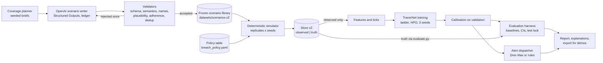
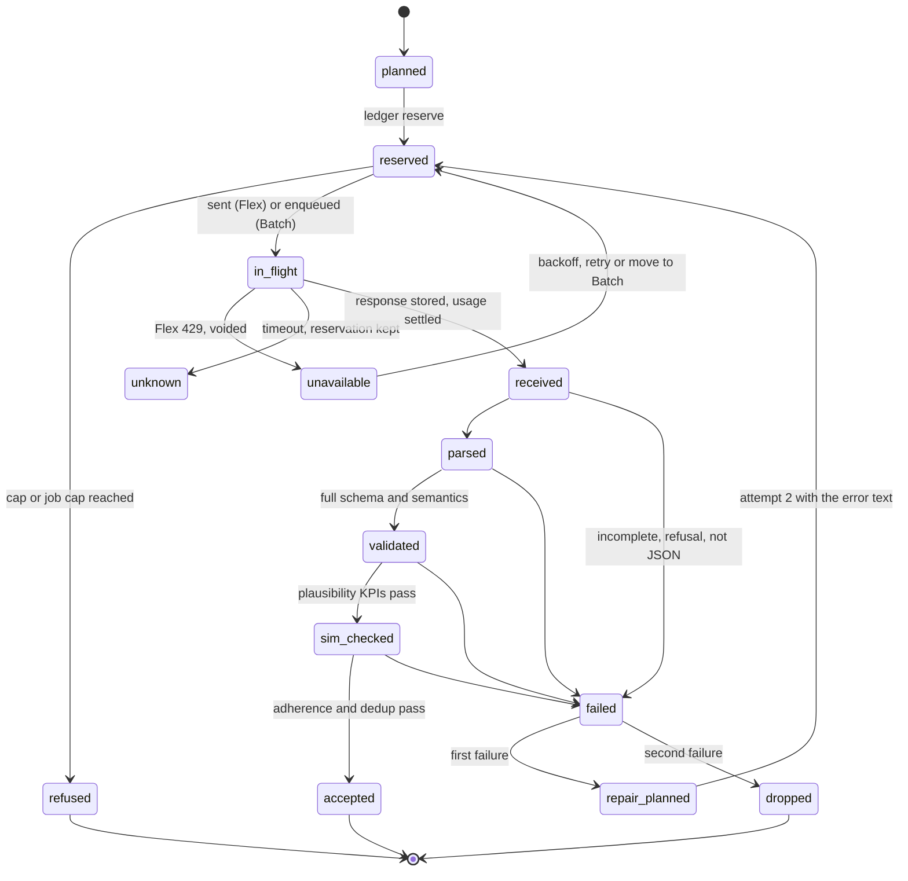
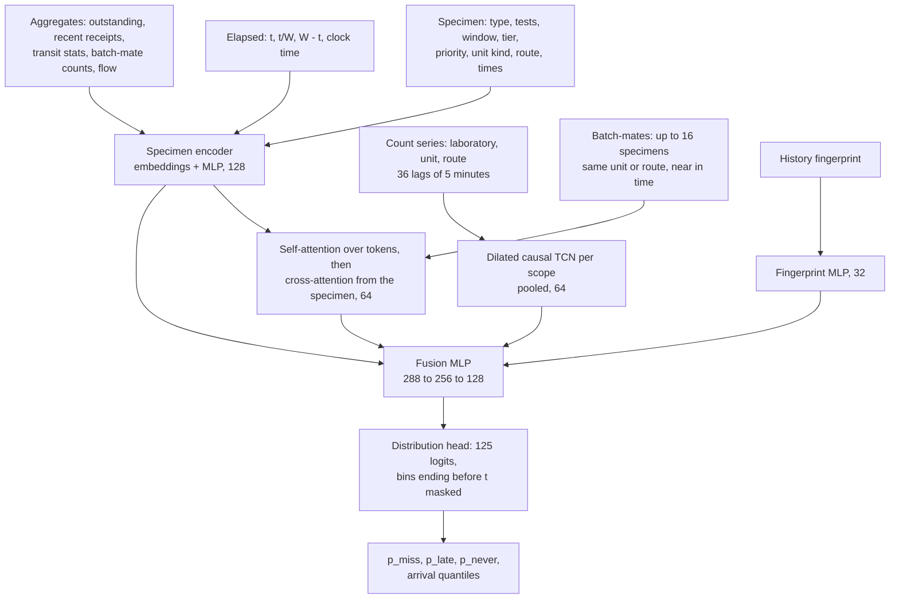
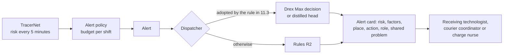
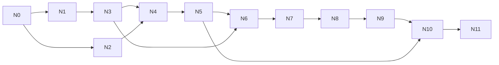

# Tracer v2: scenario data and the TracerNet risk network

Technical spec for designing, building, training and evaluating a neural network that replaces the analytic risk model, plus the data pipeline that feeds it and an optional decision layer built on Nace.AI's Drex Max v1.1, a non-generative decision model reached through OpenRouter.

- **Status:** proposed, November 8, 2026. Written for an autonomous Claude Code build; Daniel reviews after the fact.
- **Owner:** Daniel Escalante. **Policy table:** Karissa Kocourek (an input here, never edited).
- **Deadline:** TracerNet trained, evaluated and merged by **Friday, November 13 (Gate C)**. Decision layer and close-out by November 14. November 15 is buffer. Demo freeze is November 16 at 6 PM ET; the talk is November 18.
- **Hard spend caps:** OpenAI **$76.43** in total, every call included. The decision model (Drex Max through OpenRouter) **$8.00**, separate (an assumption Daniel can change; see Appendix D).
- **Read first:** `AGENTS.md`, `CLAUDE.md`, `docs/architecture.md` §4, §5, §7, §9, `src/pipeline/evaluate.py`, `src/pipeline/store.py`, `src/models/risk.py`, `src/generator/briefs.py`, `src/generator/validate.py`, `tests/test_truth_isolation.py`, `tests/test_no_key_in_site.py`.

Every number this project reports comes from synthetic data with no clinical review. This spec does not change that, and every output it describes says so.

---

## 0. Summary

Tracer scores every silent specimen every 5 minutes and alerts while it can still be recovered. Today's score is an analytic mixture-survival model fitted on 24 synthetic runs. On the 6 held-out runs, at 6 alerts per 8-hour shift, it gives 55 minutes of median warning over all breaches against 45 for a rule that alerts at a fixed share of the stability window, and the two tie at equal urgency weights.

The reason they tie is structural, and it shapes everything below. Between the collection scan and the receipt scan a specimen's own record is empty. The only things a model can use are what was known at collection, how long the specimen has been silent, its window, and what the rest of the laboratory is doing. The v1 dataset draws every specimen's timings and faults independently, with no queues and no shared failures, so the rest of the laboratory carries no information. Any model's ceiling on v1 is close to the analytic model's.

This work builds a world where the laboratory does carry information, then tests honestly whether a network can use it:

1. **Scenario data (hybrid).** Seeded code plans a coverage grid of laboratory types, transport mixes, staffing patterns, failure modes and rare edge cases. OpenAI models turn each planned cell into a coherent laboratory-week configuration (JSON under a strict schema). A deterministic simulator turns each configuration into specimen event timelines with shared resources and correlated disruptions, under Karissa's policy table. The configurations are frozen and committed; everything downstream regenerates from them at no API cost.
2. **TracerNet.** A landmark competing-risk network: at each 5-minute tick it reads the specimen, its silence and window, and the state of the laboratory (count series through a small temporal convolutional encoder, the specimens that traveled with it through an attention module, hand-built aggregates, and a summary of the laboratory's history), and outputs a probability distribution over when the receipt scan will come, including "never". The miss risk, the lost risk and an arrival forecast are read off that distribution. A 3-seed ensemble, calibrated on validation.
3. **Evaluation.** Whole scenario families the network never saw, a held-out laboratory archetype and a held-out disruption type, and the v1 held-out runs as a cross-generator check. Every method gets the same local history and sets its alert threshold the same label-free way. The decision rule is fixed in advance and extends the one in `docs/architecture.md` §5.2.1. The test set is scored once, under a lock.
4. **Decision layer (Drex Max v1.1).** A non-generative decision model used where it fits: deciding where to look and who to call for each alert, flagging alerts that look like a shared problem, and auditing generated scenarios. A direct test of whether a decision model could do the forecasting itself is included, so that question is answered with evidence.

### Decisions this spec makes

| ID | Decision | Why |
|---|---|---|
| D1 | OpenAI writes scenario configurations; code writes every event | Code owns statistics, timing tails and labels; the language model owns realism and coherence of whole laboratories, which code randomization lacks. One configuration seeds many simulated weeks. |
| D2 | The policy table is an input at simulation and scoring time | Windows, tiers and the clock come from `config/breach_policy.yaml`. The language model never writes a window. A policy change means re-simulate and retrain, with no API spend, and stale artifacts refuse to score (existing `policy_hash` rule). |
| D3 | TracerNet: landmark DeepHit-style network with lab-state encoders | The specimen's own sequence is empty during the risk interval; the sequence worth modeling is the laboratory's. Competing outcomes (on time, late, never) and non-proportional hazards rule out DeepSurv. See §7.2. |
| D4 | Built as a ladder: aggregates MLP, then the temporal encoder, then batch-mate attention | A working network exists early; each added module stays only if validation says it earns its place. |
| D5 | `gpt-6.1-terra` for most scenarios, `gpt-6.1-sol` for hard edge cases, `gpt-6-luna` tested in the pilot | Cost per accepted, on-brief scenario decides the mix after a paired pilot (§4.10). |
| D6 | Flex tier by default, Batch as fallback, worst-case reservations in a ledger | Flex costs the same as Batch without the 24-hour window; the ledger makes overspending impossible rather than unlikely. |
| D7 | Integrated gradients over ten named factor groups | Faithful, cheap for about six alerts per shift, and readable. Attention weights are shown as related specimens, never as the explanation. |
| D8 | Truth isolation preserved and extended | Model code passes the existing scanner; training reads only the observed store; evaluation reads truth only through `src/pipeline/evaluate.py`. |
| D9 | The analytic model stays primary unless TracerNet meets the pre-registered rule | A network that does not clear the bar is reported as a challenger result, as §5.2.1 already commits. |
| D10 | The decision layer is Drex Max v1.1 through OpenRouter, optional and off the critical path | It ranks first of 17 on Artificial Analysis's Decision Index (73 against a median of 64). Its 275 ms latency does not matter because decisions are precomputed for the static demo. The network, its evaluation and its report never wait on the decision model, its key or its availability. |

---

## 1. Current state (verified November 8, 2026, at commit `8686475`)

Everything in this section was read from the repository or its committed results. Items marked *assumed* were not verified.

**Data.** `datasets/tracer-synthetic-v1.jsonl.gz`, 11,967 of 12,000 specimens accepted, 30 weekly runs of 400, seed 1, written by `claude-haiku-5-5` for $2.16, policy hash `9594d7c019363261` (`datasets/manifest.json`). Each record is `{brief, trail}`: seeded code drew the specimen, its one planted fault and every leg time; the model wrote the scan events and the hidden true path; a nine-check validator (`src/generator/validate.py`) accepted or rejected each trail. Faults are drawn independently per specimen (`config/config.yaml`), and nothing models queues or congestion (`src/pipeline/sensitivity.py` says so).

**Store.** `src/pipeline/store.py` loads the dataset into `data/store/observed.duckdb` (`specimens`, `events`) and `data/store/truth.duckdb` (`truth_specimens`, `truth_segments`). Runs 0 to 23 are `fit`, 24 to 29 are `test`. Specimen ids look like `SP-r07-000123`.

**Current model.** `src/models/risk.py`: the time from collection to receipt is a mixture of a per-group normal lognormal (group = specimen type, six-hour block, priority, with a fallback chain), a pooled stalled lognormal and a pooled never-arrives share, fitted by `src/pipeline/intervals.py` into `results/interval_params.json`. Risk at silence `t` is `P(not received by W) / P(not received by t)`, 1 from the window on.

**Baselines and protocol** (`src/pipeline/evaluate.py`, `src/pipeline/triage.py`). Ticks every 5 minutes (`TICK_MIN = 5`) from 5 up to the window or the receipt. At most one alert per specimen. Three methods, one knob each: the plan's per-group quantile rule, the window-aware rule (alert once a fixed share of the window has passed), and the model (alert when risk times the tier's urgency weight reaches a threshold; weights 3-2-1 by default, with equal and 9-3-1 checks). Each knob is set by bisection on the fit runs from alert volume alone, then applied unchanged to the held-out runs. Warning is minutes from the alert to the window closing; an alert at or after the close is too late. Paired bootstrap over runs, 2,000 resamples, seed 0.

**Results** (`results/evaluation.json`, held-out runs 24 to 29: 2,378 specimens with a clock, 100 breaches, 126 shifts):

| At 6 alerts per shift | Quantile rule | Window-aware rule | Model, 3-2-1 | Model, equal |
|---|---|---|---|---|
| Median warning over all breaches (min) | 30 | 45 | 55 | 45 |
| Breaches caught (of 100) | 100 | 100 | 100 | 100 |
| Realized alerts per shift | 6.27 | 5.31 | 6.40 | 6.32 |
| False alerts | 690 | 569 | 706 | 696 |

Brier score at 30 minutes of silence is 0.109 against 0.119 for the base rate; at 60 minutes 0.182 against 0.187. Of the 100 breaches, 47 never arrived (13 lost in the tube, 34 never sent) and 74 had windows of 2 hours or less. At 6 alerts per shift the budget covers about a third of all specimens (18.9 specimens per shift), which is why every method catches every breach and only timing separates them.

**Guards in force.**
- `tests/test_truth_isolation.py` scans every module under `src/models/` for the words `truth`, `evaluate`, `planted_fault`, `dataset`, `synthetic`, `data/claude` and `jsonl`, and allows only `store.py` and `evaluate.py` to mention `open_truth` or `truth.duckdb`.
- `tests/test_no_key_in_site.py` checks published files under `docs/` for Anthropic key shapes and API host names, and checks that the Anthropic key's value is in no tracked file.
- `tests/test_mvp_snapshot.py` pins `results/mvp-nov8.json` by SHA-256. `tests/test_results_readme.py` holds the headline paragraph of `results/README.md` to that snapshot. `tests/test_docs.py` requires that the README never uses the word "simulator" (it encodes the October 28 decision that the v1 data is Claude-generated).
- `scripts/clean_clone.sh` clones, reinstalls, reruns the README's commands and fails if any committed output changes.

**Environment.** The project venv is Python 3.14.7 (Homebrew) with no `torch` installed. `.env` holds `ANTHROPIC_API_KEY`, `OPENAI_API_KEY` and `OPENROUTER_API_KEY` (only the variable names were checked; values were never read). `.env` is ignored (`.gitignore` line 22) and untracked. `.env.example` names only `ANTHROPIC_API_KEY`. The local `main` matches `origin/main`, and no pull requests are open.

**Plan.** `visuals/plan.html` (published at the plan artifact) holds tasks with ids, "Done when" lines and gates: Gate C November 13, Freeze November 16 at 6 PM, presentation November 18. Task id prefixes in use: A, C, D, F, G, J, K, M, P, S, T, V, W. This spec uses **N** for build tasks and **O** for OpenAI jobs.

---

## 2. Constraints and guardrails (binding)

1. **Spend.** OpenAI total ≤ $76.43, enforced by the ledger in §4.6 with worst-case reservations. The decision model's total ≤ $8.00 in its own ledger account (`decide`). Nothing calls either API outside the ledger.
2. **Secrets.** `OPENAI_API_KEY` and `OPENROUTER_API_KEY` live only in `.env`. They are never printed, logged, written to any file under `data/` or `results/`, or committed. `.env.example` lists each name with an empty value.
3. **Policy table.** `config/policy_table.csv`, `config/policy_sources.csv`, `config/breach_policy.yaml` and `src/generator/compile_policy.py` are read, never changed. Every new artifact carries `policy_hash` and refuses to score under a different one.
4. **Guardrails from `AGENTS.md`.** Every timing parameter is marked `source: assumed`. Nothing from Karissa's workplace appears anywhere: prompts never mention a real institution, and the scenario validator rejects real institution names (§4.8). The truth log is an oracle (§6.4, §15). Everything regenerates from a seed or from a frozen file and its manifest. A frozen file over 25 MB goes up as a GitHub release asset with its manifest and checksum committed. The demo stays static: no key, no server, no live API calls. The repository is public. Prose is plain, in American spelling, with units on numbers.
5. **Existing outputs do not move.** Every committed output of the v1 pipeline (`results/*.json`, `results/alerts.csv`, `docs/demo/*.json`, `docs/demo/qr.png`) regenerates byte for byte, and `scripts/clean_clone.sh` passes. New work writes new files only.
6. **Git.** One branch and one pull request per row of §16, squash-merged to `main` when its checks pass. No pull request is left open or in draft. No agent attribution anywhere: no `Co-Authored-By` trailers, no "Generated with" or "Generated by" lines, in commits, titles or pull request bodies. Every pull request adds its own entry to `docs/ai-teaming-log.md` before it merges, in the log's existing four-line format.
7. **The test set is touched once** (§8.7).

---

## 3. System overview



| Package or file | Role | Reads truth? |
|---|---|---|
| `src/scenarios/` (new) | Planner, prompt, OpenAI client, ledger, runners, validators, signatures, freeze | No (it writes configurations; hidden parameters live in the library, which only the simulator and store read) |
| `src/sim/` (new) | Discrete-event simulator, v2 trail validator, plausibility KPIs, v1-world adapter | Writes truth records |
| `src/pipeline/store.py` (extended) | Builds `data/store-v2/` observed and truth files | Writes truth (already allowed) |
| `src/models/tracernet/` (new) | Network, bins, features, predictor, explanations | No (must pass the existing scanner) |
| `src/neural/` (new) | Samplers, training loop, HPO, calibration, ablations, orchestrator, report | No (new scanner, §15) |
| `src/pipeline/evaluate.py` (extended) | Adds v2 accessors; stays the only reader of the truth file | Yes (allowed) |
| `src/pipeline/neural_eval.py` (new) | v2 evaluation harness, bootstrap, decision rule, test lock | Through `evaluate.py` only |
| `src/decide/` (new) | Decision-model client (OpenRouter Decisions API), state rendering, dispatcher, zero-shot test, critic, distillation | No |
| `src/pipeline/dispatch_eval.py` (new) | Scores dispatch decisions against true places | Through `evaluate.py` only |
| `src/api/export_neural.py` (new) | Prediction files and the demo adapter | Through `evaluate.py` only, like `export.py` |

---

## 4. Data generation

### 4.1 What each side owns

| Code owns | The language model owns |
|---|---|
| Which cells of the coverage grid exist and how many scenarios each gets | A coherent laboratory for the cell: units, routes, schedules, staffing, failure story |
| Every random draw, every timestamp, every label | Plausible correlations between parameters (a cancer center sends more tissue; off-site clinics use preserved urine) |
| Bounds, consistency, plausibility, deduplication, coverage accounting | Realistic disruption narratives and rare compound events that a uniform randomizer would not think of |
| Windows, tiers and the clock (from the policy table) | Nothing about the policy |

The language model writes one JSON configuration per call. It never writes an event row. A temperature is never sent (the GPT-6 family's reasoning modes do not take one, and variety must not depend on it); variety comes from the planner.

### 4.2 Coverage planner (`src/scenarios/planner.py`, `config/scenario_planner.yaml`)

`plan(job, seed)` returns a deterministic list of briefs. Each brief names one cell of the grid below, a few numeric anchors and one quirk, and asks for one laboratory-week.

| Factor | Levels |
|---|---|
| `stratum` | `normal` 35%, `stressed` 35%, `disrupted` 20%, `edge` 10% |
| `archetype` | `academic_medical_center`, `community_hospital`, `critical_access_rural`, `childrens_hospital`, `cancer_center`, `multi_site_system`, `surgical_specialty`, `safety_net_urban` |
| `size_band` | `small` (30 to 120 specimens per weekday), `medium` (120 to 350), `large` (350 to 900) |
| `transport_mix` | `tube_dominant` (≥ 70% by tube), `courier_dominant` (≥ 60% by courier), `mixed`, `offsite_heavy` (≥ 30% from off-site sites by van) |
| `staffing` | `full_24_7`, `reduced_nights`, `weekend_skeleton`, `chronic_short` |
| `failure_focus` | `random_faults_only`, `tube_outage`, `tube_degradation`, `station_neglect`, `courier_unreliable`, `unit_batching`, `understaffing_spikes`, `surge`, `instrument_coupling`, `compound`; plus `scanner_downtime` in OOD cells only |
| `edge_tags` | 1 to 3 tags from Appendix C, for the `edge` stratum only |

- **Compatibility.** `critical_access_rural` is always `small`; `academic_medical_center` is `medium` or `large`; `offsite_heavy` requires a courier van route; `normal` pairs only with `random_faults_only` or one mild chronic focus. The table lives in `config/scenario_planner.yaml`.
- **Balance.** Within each stratum the planner cycles through factor levels in a seeded order so every marginal is within one count of its target, then draws anchors (unit count, tube line count, a courier round interval, the weekday and hour of the main disruption) from seeded ranges, and one quirk from a list of 40 short texture lines ("the emergency department has its own tube line", "night couriers cover two buildings").
- **Out-of-distribution cells (pre-registered).** About 8% of the main run goes to cells that are held out of training and validation entirely: archetype `multi_site_system` (about 5%) and disruption type `scanner_downtime` (about 3%, mixed across archetypes). Both go only to `test_ood` (§6.2).
- **Brief JSON** sent to the model: `brief_id`, `stratum`, `archetype`, `size_band`, `transport_mix`, `staffing`, `failure_focus`, `edge_tags`, `anchors`, `quirk`, `must_include` (plain sentences generated from the cell, for example "at least one tube line outage lasting 45 to 120 minutes that overlaps the morning collection peak"), `must_avoid` (for example "no disruption on the warm-up day").

### 4.3 Scenario schema (`config/scenario.schema.json`, `src/scenarios/schema.py`)

Two versions of one schema are kept in `src/scenarios/schema.py`: the **API schema** (only keywords that OpenAI Structured Outputs accepts in strict mode; every property required, nullable where optional, `additionalProperties: false`, no free-form maps) and the **full schema** (the API schema plus numeric bounds, lengths and patterns), which code applies to every response. Check the strict-mode keyword list in OpenAI's current docs before writing the API schema. Shares and weights are normalized in code, so the model is never asked to make numbers sum exactly.

| Field | Type, unit | Bounds | Simulator use |
|---|---|---|---|
| `archetype`, `size_band`, `transport_mix`, `staffing`, `failure_focus` | enums | must equal the brief | adherence check; analysis slices |
| `narrative` | string | ≤ 600 characters, no proper names | none (documentation; names check) |
| `volume.specimens_per_weekday` | integer | 30 to 900, inside the brief's band | arrival rate |
| `volume.hourly_profile` | 24 numbers ≥ 0 | sum > 0 | relative arrival rate by hour (normalized) |
| `volume.weekend_factor` | number | 0.3 to 1.2 | Saturday and Sunday multiplier |
| `specimen_mix` | object with the 12 keys of `config/config.yaml` `specimen_mix` | each ≥ 0, sum > 0 | which policy rows a specimen carries (normalized) |
| `units[]` (3 to 16) | objects | | collecting units |
| `units[].unit_id` | slug | unique | |
| `units[].kind` | enum: `ed`, `icu`, `med_surg`, `periop`, `clinic_onsite`, `clinic_offsite`, `oncology`, `pediatrics`, `labor_delivery`, `dialysis`, `long_term_care` | | unit-kind embedding; mix tilt defaults |
| `units[].volume_share` | number | > 0 | share of arrivals (normalized) |
| `units[].stat_fraction` | number | 0 to 1 | priority draw |
| `units[].route` | enum: `tube`, `courier`, `walk_in`, `mixed` | `clinic_offsite` must be `courier` | route draw |
| `units[].tube_line_id`, `units[].courier_route_id` | string or null | must exist when the route uses it | route detail |
| `units[].tube_share_if_mixed` | number or null | 0 to 1, required for `mixed` | route draw |
| `units[].dispatch.mode` | enum: `immediate`, `batched` | | dispatch process |
| `units[].dispatch.median_min`, `p90_min` | minutes | 1 to 120; p90 > median, ≤ 480 | dispatch wait (lognormal) |
| `units[].dispatch.batch_interval_min` | integer or null | 15 to 240, required for `batched` | sweep times |
| `units[].not_dispatched_rate` | number | 0 to 0.05 | never-sent fault |
| `units[].mix_tilt[]` | list of `{key, multiplier}` | ≤ 6 items, multiplier 0 to 5 | unit-specific mix |
| `tube_system.lines[]` (0 to 8) | `{line_id, transit_median_min, transit_p90_min, misroute_rate, lost_rate}` | transit 1 to 20 median, p90 ≤ 45; misroute 0 to 0.03; lost 0 to 0.01 | tube legs |
| `tube_system.station_empty_interval_min` | `{day, evening, night}` | 2 to 90 | lab station emptying |
| `tube_system.stalled_rate` | number | 0 to 0.06 | carrier overlooked at the lab station |
| `tube_system.stall_extra_min` | `{median, p90}` | median 10 to 240, p90 > median, ≤ 720 | overlooked-carrier delay |
| `tube_system.misroute_found_min` | `{median, p90}` | median 10 to 120 | time to find and re-send |
| `couriers.routes[]` (0 to 6) | `{route_id, kind, round_interval_min{day,evening,night}, travel_median_min, travel_p90_min, missed_round_rate, lost_rate, capacity_per_round}` | kind in `onsite_runner`, `campus_loop`, `offsite_van`; interval 10 to 240 or null (no service that shift); travel 3 to 120 median, p90 ≤ 240; missed 0 to 0.2; lost 0 to 0.01; capacity 5 to 200 | courier legs |
| `couriers.on_call_runner` | boolean | | stat specimens on courier routes may be carried on demand |
| `couriers.on_call_response_median_min` | number or null | 5 to 60 | on-demand pickup |
| `receiving.staff_by_shift` | `{weekday:{day,evening,night}, weekend:{day,evening,night}}` integers | 1 to 12 | servers at the receiving desk |
| `receiving.shift_pattern` | enum: `7-15-23`, `6-14-22`, `7-19` | | when staffing changes |
| `receiving.scan_service_min` | `{median, p90}` | median 0.3 to 5 | service time per specimen |
| `receiving.shift_change_gap_min` | integer | 0 to 45 | reduced coverage after each change |
| `processing.accession_min`, `processing.plating_min` | `{median, p90}` | median 2 to 120 | post-receipt waits |
| `processing.instruments[]` (0 to 4) | `{name, downtime_per_week, downtime_median_min}` | 0 to 3 per week; 10 to 480 minutes | post-receipt delays |
| `processing.staff_pull_from_receiving` | number | 0 to 1 | share of receiving capacity diverted while an instrument is down |
| `independent_faults` | `{never_collected_rate, content_failure_rate}` | 0 to 0.02; 0 to 0.05 | v1-style faults |
| `disruptions[]` (0 to 14) | `{disruption_id, type, target_id, day, start, duration_min, severity, response, noticed_after_min, recurs_daily}` | type in §5.5; day 0 to 6; start `HH:MM`; duration 10 to 720; severity 0.1 to 1; noticed 0 to 240 | §5.5 |
| `edge_tags` | list of enums (Appendix C) | must include the brief's tags | adherence |
| `realism_notes` | string | ≤ 400 characters | documentation |

Code adds `scenario_id`, `family_id`, `brief_id`, `job`, `model`, `reasoning_effort`, `prompt_hash`, `schema_hash`, `policy_hash`, `created_at`, a display name ("Scenario 0412, community hospital"; the model never names a laboratory) and `source: "assumed"` at the top level and in each timing section. Hidden dynamics (fault rates, the disruption schedule) and the observable roster (units, routes, scheduled rounds, staffing) live in the same record; only the simulator and `store.py` read the record, and only the roster reaches the observed store (§6.4).

### 4.4 Request design (`src/scenarios/prompt.py`, `src/scenarios/client.py`)

- **Endpoint.** The Responses API, with Structured Outputs in strict mode (`text.format` of type `json_schema` with `strict: true`, in the shape the current docs give), `reasoning.effort` per job, `max_output_tokens` per job (§4.5), `store: false`, and `service_tier: "flex"` unless a stage says otherwise. Read OpenAI's current docs for the Responses API, Structured Outputs, prompt caching, Flex and Batch before writing the client; the parameter names above are what this spec expects, and the docs win where they differ.
- **Layout for caching.** The developer message is stable for a whole job and comes first: role and purpose (a synthetic research simulator; no real institution or person), field-by-field semantics with the simulator effect of each field, the bounds, the consistency rules, how to realize every brief field, realism guidance with every range marked as an assumption, and one worked example configuration. The brief is the last item. Pass a per-job prompt cache key if the current API offers one.
- **The prompt never contains** a window value from a real workplace, any real institution name, or anything from Karissa's workplace. It may describe the policy table's specimen types, transport conditions and windows, since those are in the public repository.
- **Prompt hash.** `prompt_hash = sha256(developer text + API schema + model + effort)[:16]`, recorded on every response and in the manifest, as `src/generator/prompt.py` does.
- **Parsing.** A response counts only when its status is `completed`, it has no refusal, and the output parses and passes the full schema. `incomplete` (for example `max_output_tokens`) is billed and counts as a failure.
- **Usage.** Record `input_tokens`, cached input tokens, `output_tokens` and reasoning tokens from the response's usage object, plus the request id, service tier actually used, status and timing. Never record headers.

### 4.5 Model choice and budget

**Prices observed on November 9, 2026** (OpenAI's pricing page and model pages; USD per million tokens). These must be re-verified on the official pricing page and written to `config/openai_prices.yaml` before every spending stage (Appendix A).

| Model | Standard: input / cached / output | Batch and Flex: input / cached / output | Reasoning effort | Rate limits at the Build tier |
|---|---|---|---|---|
| `gpt-6-astra` | 10.00 / 1.00 / 50.00 | 5.00 / 0.50 / 25.00 | (not used) | |
| `gpt-6.1-sol` | 2.00 / 0.10 / 10.00 | 1.00 / 0.05 / 5.00 | low, medium (default), high, xhigh, max | 5,000 RPM, 1M TPM |
| `gpt-6.1-terra` | 1.00 / 0.05 / 5.00 | 0.50 / 0.025 / 2.50 | none, low, medium (default), high, xhigh, max | 5,000 RPM, 1M TPM, batch queue 3M tokens |
| `gpt-6-luna` | 0.10 / 0.01 / 0.50 | 0.05 / 0.005 / 0.25 | none, low, medium (default), high, xhigh, max | 5,000 RPM, 2M TPM, batch queue 20M tokens |

Cache writes are listed at 1.25 times the input rate (30-minute retention). Batch and Flex cached rates are half the standard ones by the page's statement that Batch and Flex halve every rate; verify. All three models list Structured Outputs and the Batch endpoint. The account's tier is unknown: read the rate-limit response headers on the first calls and size concurrency and batch chunks from them.

**Why these models.** Configurations are long structured objects whose fields must agree with each other and with a brief; that needs a capable model, but not the most expensive one. `gpt-6-astra` costs five times `gpt-6.1-sol` per token and buys little for JSON configuration. `gpt-6.1-terra` at low effort is the bulk writer. `gpt-6.1-sol` at medium effort writes the edge stratum, where compound events and adherence to unusual briefs matter most. `gpt-6-luna` is a tenth of `terra`'s price; if the pilot shows it writes `normal`-stratum laboratories as well as `terra`, it takes that stratum and the savings buy more variety elsewhere.

**Per-scenario estimate** (to be replaced by pilot measurements). About 7,000 input tokens (6,500 stable prefix plus 400 of brief), 2,500 visible output tokens, and reasoning tokens that bill as output.

| Model, effort | Reasoning tokens (assumed) | Expected cost at Flex or Batch rates, no caching | `max_output_tokens` | Worst case reserved, at Standard rates |
|---|---|---|---|---|
| `gpt-6-luna`, low | 1,000 | $0.0012 | 12,000 | $0.0118 |
| `gpt-6.1-terra`, low | 1,500 | $0.0135 | 16,000 | $0.1381 |
| `gpt-6.1-terra`, medium | 3,500 | $0.0185 | 20,000 | $0.1581 |
| `gpt-6.1-sol`, medium | 4,000 | $0.0395 | 24,000 | $0.3562 |

Worst case = the request's input bound priced at the Standard cache-write rate (the highest input rate a request with 30-minute retention can be billed) plus `max_output_tokens` (which include reasoning) at the Standard output rate. The input bound is the UTF-8 byte length of the whole serialized request (every message, the JSON schema and format block, the model name and every other field), which a byte-level BPE tokenizer cannot exceed since each token covers at least one byte, plus a framing allowance of 64 tokens per request and 16 per message for the server's own message and schema rendering. The byte part is a guarantee; the framing allowance is an assumption (OpenAI documents no ceiling for it), backed by measurement: the pilot billed a median of 10,524 input tokens against a bound of about 46,500, so the allowance would have to be wrong by more than 35,000 tokens to matter, and a response billed above its bound stops the job. With the real prompt and schema an O2 request is about 46,400 bytes (46,368 at the median of the 6,101 O2 briefs, 46,782 at most), so its bound is about 46,500 tokens; the figures above are at that median. Every request is reserved at Standard rates whatever tier it asks for, because a Flex request can be served and billed at Standard and Flex and Batch are half of Standard; settlement prices the tier actually served. A bound past 272,000 tokens (long-context pricing, which the price table lacks) cannot be reserved.

**Allocation of $76.43.**

| Line | Cap | Use | Expected yield |
|---|---|---|---|
| Hard margin | $2.43 | Never reserved. Absorbs price-table or usage-reporting drift. | none |
| O1 Pilot | $3.00 | 24 shared briefs (6 per stratum) on each of `luna`-low, `terra`-low and `sol`-medium, plus one repair each where needed | about 70 scenarios and the measurements that set O2 |
| O1b Pilot retry | $2.00 | Only if the pilot gate fails once and the prompt is revised | |
| O2 Main run | $44.00 | Default mix: `normal`, `stressed` and `disrupted` on `terra`-low (or `luna`-low for `normal`, if it passes); `edge` on `sol`-medium; one repair per rejected scenario | about 2,250 accepted at the estimates above (≥ 2,000 required) |
| O3 Round 2 | $18.00 | Targeted at validation weak spots (§4.12); about 40% `sol`-medium, 60% `terra`-low | about 600 accepted |
| Contingency | $7.00 | Released only by the rule below | |
| **Total** | **$76.43** | | |

**The raise of November 13, 2026.** The account's cap rose by exactly $60, to $136.43, for the second rule of `docs/neural/preregistration-v2.md`: O4 ($8.00) fills the in-distribution coverage cells left below target, and T1 ($20.00) is the fresh test set. The job caps then sum to $102.00, so at least $10 of the account can never be spent. The ledger records the raise once, from the account's dated `raises` entry in `config/openai_jobs.yaml`.

Counts are computed at run time as `floor(cap / (measured cost per accepted scenario))` per model and stratum, with the stratum shares above. The contingency is released to an O3b only after O2 and O3 are settled, and only if the round-2 slices on validation are still the worst slices after retraining. Unused money stays unspent.

**Execution tier.** Flex is the default for O1 to O3: Batch prices, synchronous responses, no 24-hour window. A Flex `429 Resource Unavailable` is not billed; retry it with exponential backoff and jitter (up to 6 tries over about 20 minutes), then move the item to Batch. Batch submissions are chunked so the enqueued input tokens stay under the model's queue limit (default 2.5M, or the limit the account shows), and a chunk not finished after 6 hours is cancelled: its items whose lines say `batch_expired` go back to Flex, and the rest are settled as unknown and get their repair attempt. Standard tier is used only when a stage would otherwise miss its day, and its reservations are at Standard rates. Client timeout for Flex is 15 minutes.

### 4.6 Ledger and spend control (`src/scenarios/ledger.py`)

The ledger makes overspending impossible: no request leaves the machine without a reservation that covers its worst case.

- **Storage.** SQLite in WAL mode at `data/openai/ledger.sqlite` (local; `data/` is ignored), with a human-readable mirror `data/openai/ledger.jsonl`. Tables: `accounts` (`openai`, `decide`) with `cap_usd`; `jobs` (O1, O1b, O2, O3, O3b, and the decision-model jobs X1 to X4) with `cap_usd` and `released` flag; `entries` (`entry_id`, `account`, `job`, `item_id`, `kind` in `reserve`, `settle`, `release`, `void`, `adjust`, `usd`, `at`, `request_id`, `detail`).
- **Reserve.** Inside one `BEGIN IMMEDIATE` transaction: compute `spent = sum(settle) + sum(adjust)` and `held = sum(reserve) − sum(release) − sum(settle-matched)`; refuse unless `spent + held + new ≤ account cap − hard margin` and the job's own total stays within the job cap. The reservation is the worst case of §4.5, at Standard rates whatever tier is requested. It is recomputed from the current price table and the request's input bound before every send; an unsent reservation smaller than that is replaced (a `void` and a larger `reserve` in one transaction, under the same checks), and if the larger one does not fit, the request is refused and never sent.
- **Settle.** When a response arrives, price its reported usage with the price table (uncached input at the cache-write rate unless the usage object breaks writes out; cached input at the cached rate; output including reasoning at the output rate; the tier actually served), write `settle`, and `release` the remainder of the reservation.
- **Unknown outcome.** One classifier decides every synchronous and Batch outcome. Only outcomes proven unbilled are `void`: any 429 (a Flex `429 Resource Unavailable`, which the docs say is not charged; a rate limit; a quota or spend-limit refusal), a 4xx raised before the request ran (400, 401, 403, 404, 409, 413, 415, 422), and a Batch line coded `batch_expired`. An error that reports usage is settled from that usage (an error names no served tier, so at Standard rates). Everything else (a client timeout, a dropped connection, every 5xx, 408, any other Batch error line, an error that says tokens were consumed without a usable usage object) keeps the full reservation as `settle`, and its brief gets the repair attempt; the identical request is never sent again. The client keeps an error body's usage as token counts only. When half of the last ten answered requests end this way, the job stops.
- **Batch.** Reserve the sum of the chunk's worst cases at submission; settle per output line; release the rest when the chunk ends, expires or is cancelled. Expired items are billed only for completed requests, which is what the per-line settlement records. A request whose response is stored is answered from the store and never uploaded. A chunk whose creation is uncertain (a timeout, 408, 5xx or crash after the create call) keeps every reservation; collect searches every page of the batch list for its id, and a miss is not proof that nothing ran, so its items are settled as unknown and get their repairs, never a resubmission. Only an upload failure, or a create call refused with one of the 4xx above or a 429, voids the chunk.
- **Price table.** `config/openai_prices.yaml` holds per-model, per-tier rates, `verified_at` (ISO date and time), `source_url` and the person or agent who checked. A spending command refuses to run if the table is older than 24 hours, is dated more than five minutes ahead or without a time zone, or lacks the model and tier it would use (every reservation needs the model's Standard rates).
- **Dry run.** `python -m src.neural.pipeline dry-run --job O2` builds every request of the job (deterministic briefs, real prompts) and prints per model and stratum: requests, the estimated input and the input bound per request, expected cost (the local estimate, characters / 2.5 with a 15% margin, at the tier's rates), worst-case cost (§4.5, what generate reserves), ledger headroom and job cap, with the measured median input of stored responses beside the estimate. It writes `data/openai/dryrun-O2.json` with the request-set hash, spends nothing and opens no connection. A spending command refuses to run unless a dry run with the same request-set hash exists from the last 24 hours, dated with a time zone and at most five minutes ahead; it sends only that request set and the repairs it spawns, and leaves any other pending item unsent.
- **Order.** O1 needs a dry run. O2 needs the O1 gate to have passed (§4.10). O3 needs a trained model's validation weak-spot report (§4.12). Each needs `--budget-usd` no greater than its job cap.
- **Reconciliation.** After each job, `ledger report` prints settled totals per job and model next to the sums of reported tokens, and the manifest records them. Daniel can compare with OpenAI's usage page; if the two disagree by more than 5% or $1, work stops and Daniel is asked.
- **Concurrency.** One generator process at a time (a lock file in `data/openai/`); worker threads share the SQLite ledger through the transaction above.

### 4.7 Execution, caching and resume (`src/scenarios/runner.py`)

Every request is an item with a stable `item_id = f"{job}-{brief_id}-{attempt}"`. Its state is stored in `data/openai/items.sqlite` and every transition is appended to `data/openai/items.jsonl`.



- **Response cache.** Every raw response is stored at `data/openai/responses/<request_hash>.json` before anything parses it. `request_hash` covers model, parameters and messages. A rerun never sends a request whose response is cached, by Flex, Standard or Batch.
- **Resume.** On start the runner rebuilds item states from the store, re-attaches to open batch chunks by id, and treats `unknown` items as billed and finished (they get a repair attempt, never a silent resend). An item whose reservation the ledger already closed (a crash between the ledger write and the item's move) follows that closing entry instead of being settled or voided again.
- **Repair.** One repair per brief, with the validator's error text appended to the brief, as v1 does. A second failure drops the brief and logs why.
- **Concurrency.** Start with 8 Flex workers and adapt to the rate-limit headers, keeping requested tokens per minute under 80% of the limit. Requested tokens count input plus `max_output_tokens`.
- **Logs** never include headers, the key, or full prompts. Exceptions are caught at the client boundary and re-raised with the status, error type and request id only.

### 4.8 Validation (`src/scenarios/validate.py`, `src/sim/kpi.py`)

Applied in order; the first failing layer's errors are what a repair request receives.

1. **Full schema.** JSON Schema Draft 2020-12 with all bounds (the repository already depends on `jsonschema`).
2. **Semantics.** Ids unique; every referenced line, route and unit exists; `mixed` units have a tube share; `clinic_offsite` units use a van route; every shift with arrivals has at least one receiving staff member; disruption targets exist and match their type; disruptions start and end inside days 0 to 6 plus 12 hours; overlapping disruptions on one target are allowed and combine by the stronger severity; the hourly profile is not flat unless the brief asks for it; adherence to the brief's fixed fields.
3. **Names and safety.** The narrative and notes contain no personal names or dates of birth (reuse the patterns of `src/generator/validate.py` check 9), no word pair that looks like an institution name (a capitalized word followed by Hospital, Medical Center, Clinic, Health, University or Health System), and nothing from a denylist that includes at least Mayo, Cleveland Clinic, Johns Hopkins, Kaiser, HCA, Ascension, Baptist, Shands and UF Health.
4. **Plausibility by simulation.** Simulate the whole scored week of replicate 99 (a seed reserved for checks), with its warm-up and warm-down days, and require the KPIs of §5.10.
5. **Brief adherence.** Every `must_include` sentence has a code predicate (Appendix C and `config/scenario_planner.yaml`); all must hold.
6. **Diversity.** §4.9.

### 4.9 Diversity, deduplication and coverage (`src/scenarios/signature.py`)

- **Signature.** A 32-number vector per scenario: log volume, weekend factor, unit count, route shares by volume (tube, courier, walk-in, off-site), tube line count, courier route count, mean round interval by shift, receiving staff per 100 daily specimens by shift, logits of the fault rates, disruption counts by type, total disruption minutes, mix entropy, the first three principal components of the hourly profile (fitted on the pilot), and the plausibility KPIs (median collection-to-receipt time by route, breach share, never-received share). Standardized with a robust scaler fitted on the pilot plus the main run.
- **Near duplicates.** Two scenarios of the same archetype are near duplicates when their standardized distance is below δ, with δ set to half the median nearest-neighbor distance in the accepted pilot. The later one by `item_id` is rejected (it does not get a repair).
- **Families.** Union-find over pairs closer than 1.5δ, regardless of archetype, gives `family_id`. Splits are made by family (§6.2).
- **Coverage.** Counts per cell against targets, per factor marginal (each ≥ 90% of target), and per edge tag.
- **Dispersion.** Mean nearest-neighbor distance and the Vendi score (exponential of the entropy of the eigenvalues of an RBF similarity matrix divided by n) per stratum and overall, beside the same numbers for 2,000 code-random scenarios (§8.8, A4). These are reported, not gated: a realistic library is expected to be less dispersed than a uniform one.
- **Collapse check.** Within each stratum, the coefficient of variation across scenarios of median transit and of breach share must be at least 0.15; a stratum below it is flagged and gets more anchors in the next job.

### 4.10 Pilot (O1) and the gate

The pilot sends the same 24 briefs to each of the three models, so their comparison is paired. The gate is computed per model:

| Gate | Requirement |
|---|---|
| G1 Structure | ≥ 95% of responses complete and pass the full schema on the first attempt |
| G2 Acceptance | ≥ 80% accepted after at most one repair |
| G3 Adherence | ≥ 85% of accepted scenarios satisfy every `must_include` predicate |
| G4 Duplicates | ≤ 5% near duplicates among accepted |
| G5 Cost | measured cost per accepted scenario within 1.5 times the estimate (if not, the O2 counts are recomputed; not a failure) |
| G6 Variety | the collapse check of §4.9 passes in every stratum the model wrote |

**Model rule.** For the core strata, use the cheapest model whose G2 and G3 rates are within 5 percentage points of the best model's. For the `edge` stratum, use the cheapest model with G3 ≥ 85%. If no model passes G1 to G4 and G6, revise the prompt once inside O1b and repeat the pilot on 12 new briefs per model; if it still fails, stop and ask Daniel. The pilot report (`results/neural/generation/pilot.md` and `.json`) gives every gate per model with counts and cost, and accepted pilot scenarios join the library.

### 4.11 Freeze and manifest (`src/scenarios/freeze.py`)

- `datasets/scenarios-v2.jsonl.gz`: one sorted-key JSON line per accepted scenario, gzip with `mtime=0` (deterministic, as `src/generator/collect.py` does). Expected size 3 to 8 MB, committed directly.
- `datasets/scenarios-v2.manifest.json`: SHA-256 and bytes; created time; jobs with model, effort, tier, prompt hash and schema hash; policy hash; planner seed and config hash; requested, accepted, repaired and dropped counts by job, model, stratum and archetype; rejection reasons; near-duplicate count; coverage table; dispersion numbers; ledger totals per job and the grand total; the price table's `verified_at`; family and split counts; the OOD definition; `"clinical_review": "none"`; and a note that every parameter is an assumption written by a language model for a synthetic simulator.
- The freeze can run more than once (after O2 and after O3). A later freeze appends scenarios but never changes or reorders an existing family's split.

### 4.12 Round 2: weak spots (O3)

1. Train the chosen model on the O2 data (§7.9) and score validation.
2. For each slice (archetype by stratum, disruption type, route kind, window class, volume tercile, edge tag) with at least 30 validation breaches, compute the excess miss log loss over the slice's own base rate and TracerNet's median-warning gap to the best baseline.
3. Rank slices by excess loss times the slice's share of validation breaches; take the top four.
4. Plan O3 briefs: 60% in those four slices (with new anchors and quirks), 25% general `edge` briefs, 15% for cells below their coverage targets.
5. O3 scenarios are split 85% train and 15% validation by family. None go to any test set; test sets are fixed before O3 is planned.
6. Write `results/neural/generation/round2.md` naming the slices, the numbers that chose them, and the spend.

---

## 5. The simulator (`src/sim/`)

### 5.1 Principles

- **Deterministic discrete-event simulation.** A heap of events ordered by `(time, priority class, sequence number)`. The same scenario and the same seeds give byte-identical output.
- **v1-compatible records.** Each specimen is emitted as `{brief, trail}` in the v1 shape (§5.7), so `store.py`, `evaluate.py` and the v1 validator's checks apply unchanged.
- **The observation model is `config/workflow_graph.yaml`.** Only states with `scan: true` produce observed events. `dispatched`, `in_tube`, `at_station`, `stalled_at_station`, `misrouted` and `lost` produce none.
- **Labels come from the policy** (§5.8), never from the scenario.
- Pure Python and numpy. No API calls. No new heavy dependency.

### 5.2 Time and calendar

- Minutes as floats inside; timestamps written as naive local ISO 8601 to the second, as v1 does. No time zones, no daylight saving.
- Day 0 of every replicate is Monday, January 5, 2026. Arrivals start at day −1, 00:00 (a warm-up Sunday, so queues are populated) and continue through day 7, 24:00 (a warm-down day, so the last scored specimens travel through real traffic). Scored specimens are those collected in `[day 0 00:00, day 7 00:00)`; the rest are traffic, present in every context feature but never labeled or scored.
- The simulation stops once every specimen collected before day 8 is received, rejected, or 7,200 minutes past its collection. A specimen with no receipt by then is "never received".
- Disruption days 0 to 6 are scored days.

### 5.3 Entities and resources

| Entity | From the scenario | Behavior |
|---|---|---|
| Collecting unit | `units[]` | Generates arrivals; holds specimens until dispatch; may batch; may never send one |
| Tube line | `tube_system.lines[]` | Carries carriers from the unit's station to the laboratory's tube station; may misroute, lose, slow down or stop |
| Laboratory tube station | `tube_system.*` | Holds arrived carriers until the next emptying; may overlook one |
| Misroute station | (fixed) | Where a misrouted carrier lands until it is found and re-sent |
| Receiving desk | `receiving.*` | A multi-server queue, stat first, that ends with the receipt scan |
| Courier route | `couriers.routes[]` | Rounds that pick up waiting specimens at their units and deliver them to the receiving desk |
| On-call runner | `couriers.on_call_runner` | Carries stat specimens on courier routes on demand |
| Processing bench | `processing.*` | Accession and plating after receipt; instruments go down and pull receiving staff |
| Staffing clock | `receiving.shift_pattern`, `staff_by_shift`, `shift_change_gap_min` | Server counts by shift and day type; half capacity (at least one) during the gap after each change |

### 5.4 One specimen, step by step

1. **Collection.** Arrival at unit `u` at time `c`. The specimen's mix entry is drawn from the global mix times the unit's tilt; its tests and governing policy come from `config.resolve` (shortest window, ties to the more urgent tier); priority is stat with the unit's `stat_fraction`; route is the unit's route (`mixed` draws tube with `tube_share_if_mixed`). An ordered scan is written with probability 0.7, 5 to 60 minutes before collection, as v1 allows. With `never_collected_rate` the draw never happens: only the ordered scan exists, and the specimen has no clock.
2. **At the unit.** With the unit's `not_dispatched_rate` the specimen is never sent (fault `not_dispatched`). Otherwise it is dispatched at `d`: immediately after a lognormal dispatch wait, or at the next sweep for a batching unit (stat specimens skip the sweep). A `unit_batching_hold` disruption turns any unit into a batching one while it lasts.
3. **Tube route.** At `d`, if the line has an outage that staff have noticed (`d ≥ start + noticed_after_min`), the disruption's `response` applies: `hold_at_unit` keeps the specimen at the unit until the outage ends, `divert_to_courier` hands it to the unit's courier route or the on-call runner (and falls back to holding if neither exists), `stuck_in_system` sends it anyway. A carrier sent into an outage, noticed or not, is stuck until the outage ends and is lost with probability `min(0.5, lost_rate × (1 + 20 × severity))`. Otherwise transit is lognormal, slowed by any degradation; the carrier is misrouted or lost at the line's rates (raised by degradation). A misrouted carrier sits at the misroute station until found, then is re-sent with a second transit. A lost carrier ends in an open-ended `lost` segment at the unit's tube station.
4. **Laboratory tube station.** Carriers wait for the next emptying. Emptying happens every `station_empty_interval_min` of the current shift (±20% jitter) while at least one receiving server is on duty and no `station_unattended` disruption is active. Each carrier is overlooked with `stalled_rate` and waits an extra lognormal `stall_extra_min` (fault `stalled_at_station`). Emptied carriers join the receiving desk queue.
5. **Courier route.** The specimen waits at its unit for the next round at that unit at or after `d`. Rounds run every `round_interval_min` of the current shift with a per-route phase and ±10% jitter; no service when the interval is null. A round is missed with `missed_round_rate` (raised by `courier_missed_rounds`), delayed by `courier_delayed`, absent during `offsite_route_closed`, and limited by `capacity_per_round` (overflow waits for the next round). Travel is lognormal. A specimen is lost in transit with the route's `lost_rate` (fault `lost_in_transit`, new in v2). With `on_call_runner`, a stat specimen is picked up after a lognormal response (90th percentile three times the median) and carried in a lognormal 8-minute median, 20-minute 90th percentile walk, unless its route is an off-site van.
6. **Walk-in route.** Dispatch wait, then a lognormal walk (10-minute median, 30-minute 90th percentile) to the receiving desk.
7. **Receiving desk.** First come, first served, stat first. Servers at time `t` are the shift's staff, halved during a shift-change gap, reduced by `receiving_short_staffed` and by `staff_pull_from_receiving` while an instrument is down, never below one. Service time is lognormal. Service completion writes the `received` event at `lab_receiving`. During `scanner_downtime` service continues but the scan is deferred: the backlog is scanned at the service rate after the downtime ends, and the scan time is the receipt time (no backdating, so no event ever appears in the stream before it was recorded).
8. **After receipt.** Accession after a lognormal wait, then plating after another (waiting for an instrument that is down). A content failure is rejected at accessioning instead. These events never move the label under today's policy.

**Truth states.** v2 keeps v1's truth states and adds a `substate` column. The dispatcher's place categories (§11) are derived from them.

| Situation | Truth state | Substate | Place category |
|---|---|---|---|
| At the unit before dispatch | `at_unit` | `pre_dispatch` | `still_at_unit` |
| Held at the unit during an outage | `at_unit` | `outage_hold` | `still_at_unit` |
| Dispatched, waiting for courier pickup | `at_unit` | `awaiting_pickup` | `waiting_for_courier` |
| Never sent | `at_unit` (open-ended) | `not_dispatched` | `still_at_unit` |
| In a tube, moving or stuck | `in_tube` | `transit` or `stuck` | `in_tube_system` |
| At the misroute station or being re-sent | `misrouted` | `wrong_station` | `misrouted_elsewhere` |
| At the laboratory tube station | `at_station` | `lab_station` | `at_lab_tube_station` |
| Overlooked at the laboratory tube station | `stalled_at_station` | `overlooked` or `unattended` | `at_lab_tube_station` |
| In the receiving queue, tube | `at_station` | `receiving_queue` | `in_lab_awaiting_scan` |
| With a courier or walking | `hand_carry` | `in_transit` or `walk` | `with_courier` |
| In the receiving queue, courier or walk-in | `hand_carry` | `receiving_queue` | `in_lab_awaiting_scan` |
| Scan deferred by scanner downtime | `at_station` or `hand_carry` | `scanner_backlog` | `in_lab_awaiting_scan` |
| Lost in a tube or in transit | `lost` (open-ended) | `in_tube` or `in_transit` | `lost` |
| After receipt | `at_receiving_bench`, `accessioned`, `plated` | none | not alertable |

### 5.5 Disruptions

| Type | Target | Effect while active | Severity `s` | `response` |
|---|---|---|---|---|
| `tube_line_outage` | tube line | Nothing moves on the line; carriers inside are stuck; new dispatches follow `response` once noticed | raises loss of stuck carriers | `hold_at_unit`, `divert_to_courier`, `stuck_in_system` |
| `tube_line_degraded` | tube line | Transit × (1 + 3s); misroute rate × (1 + 5s) | strength | `none` |
| `station_unattended` | laboratory station | No emptying | unused | `none` |
| `receiving_short_staffed` | receiving desk | Servers × (1 − s), at least one | share of staff missing | `none` |
| `courier_missed_rounds` | courier route | Each round missed with probability max(base rate, s) | probability | `none` |
| `courier_delayed` | courier route | Rounds late by s × interval; travel × (1 + s) | strength | `none` |
| `unit_surge` | unit | The unit's arrival rate × (1 + 3s) | strength | `none` |
| `unit_batching_hold` | unit | Sweeps every 30 + 150s minutes; stat exempt | strength | `none` |
| `scanner_downtime` | receiving desk | Receipt scans deferred to the end of the window | unused | `none` |
| `instrument_down` | instrument | Plating waits for the end; receiving servers × (1 − `staff_pull_from_receiving`) | unused | `none` |
| `offsite_route_closed` | off-site van route | No rounds | unused | `none` |

`recurs_daily: true` repeats the window on every scored day (chronic patterns such as a nightly unattended station). Two disruptions of one type on one target combine by the larger severity.

### 5.6 Stochastic components and seeds

- **Lognormal from median and 90th percentile**, as v1 does: μ = ln(median), σ = ln(p90 / median) / 1.2816. v2 keeps seconds rather than rounding to whole minutes.
- **Arrivals:** a non-homogeneous Poisson process by thinning, with rate `specimens_per_weekday × profile[h] / Σ profile / 60` per minute, times `weekend_factor` on Saturday and Sunday, times any surge.
- **Streams:** `np.random.SeedSequence([MASTER_SEED, scenario_index, replicate])` spawns named streams (`arrivals`, `attributes`, `dispatch`, `tube`, `station`, `receiving`, `courier`, `processing`, `faults`, `jitter`). `MASTER_SEED` lives in `config/neural.yaml`. Replicate 99 is reserved for plausibility checks.
- **Common random numbers:** each specimen's latent uniforms (dispatch quantile, transit quantile, fault draws) are drawn in bulk in arrival order from their streams, so changing a disruption or a capacity leaves every specimen's own draws unchanged. Tests and the disruption ablation use this to compare paired worlds.

### 5.7 Records and files

- **Ids.** `run_key = 100000 + 10 × scenario_index + replicate`, so ids look like `SP-r104123-000057`, match the bundle schema's pattern, and never collide with v1's runs.
- **Brief:** `specimen_id`; `fixed` (`type`, `tests`, `unit` as the unit id, `priority`, `route` as `tube` or `hand_carry` (courier and walk-in map to `hand_carry`), `collected_at`); `planted_fault` (the v1 values plus `lost_in_transit`); `targets` (the realized minutes for every v1 target key, `None` where a stage did not happen; waits for courier pickup count in `dispatch_wait_min`, receiving-queue time counts in `station_dwell_min` or `hand_carry_min`); `locations`; `label` (as v1); and `v2` (`scenario_id`, `family_id`, `replicate`, `unit_kind`, `route_kind`, `route_id`, `scored`, `cause` in `none`, `independent`, `disruption`, `congestion`, `disruption_ids`, `outcome_class`).
- **Trail:** `specimen_id`, `observed_events` (activity, timestamp, location, actor role; no notes), `truth_segments` (state, start, end, location, `substate`), `outcome` (`fault`, `received`, `plated`).
- **Locations:** `{unit_id}_collection`, `tube_station_{unit_id}`, `tube_station_lab`, `tube_station_misroute`, `courier_{route_id}`, `lab_receiving`, `lab_bench_1`, `lab_bench_2`. The v1-world adapter uses v1's names (`tube_station_pharmacy` for misroutes).
- **Files:** `data/sim/<split>/<scenario_id>/rep-<r>.jsonl.gz` (deterministic gzip, sorted keys), `roster.json` (what the laboratory knows about itself), `disruptions-rep-<r>.json` (realized windows, truth side), and `data/sim/manifest.json` with every file's SHA-256 and counts.

### 5.8 Labels

- The governing policy is `config.resolve(policy, type, tests)`. Its own `clock_start` and `clock_stop` are timed from the realized timeline; a state the simulator does not time is a `PolicyError`, as in v1.
- `breach` is true when the clock never stops within 7,200 minutes or stops after the window.
- `outcome_class`: `no_clock` (never collected), `on_time` (clock stop within the window), `late` (after the window, within 7,200 minutes), `lost` (no clock stop within 7,200 minutes). Under today's policy all four are derivable from scans and the policy alone, so the network's targets need no truth and `evaluate.load_specs`'s agreement check holds by construction.
- If Karissa's table changes, the library stays valid: re-simulate (labels follow the new policy), rebuild the store, retrain. No API spend.

### 5.9 Invariants and the v2 trail validator (`src/sim/validate_v2.py`)

- Observed events are in time order, each activity at most once, the first is `ordered` or `collected` (v1 check 2); no observed event at a hidden location (v1 check 3).
- Truth segments are contiguous from `collected_at`, with no gaps or overlaps; only `lost`, never-sent `at_unit` and the final post-receipt segment may be open-ended.
- The `received` event is within one second of the end of the last pre-receipt segment.
- Faults agree with the trail: `lost` if and only if no receipt; `not_dispatched` is one open-ended `at_unit` segment; a content failure has `rejected` and no `accessioned` or `plated`.
- Resources: the desk never serves more specimens at once than it has servers; stat-first order holds; no carrier leaves the laboratory station between emptyings except an overlooked one leaving at its own time; courier capacity holds.
- Every scored specimen has exactly one outcome class, and its label equals the scan-derived label.

**v1-world compatibility** (`src/sim/v1world.py`). A scenario built from `config/config.yaml`: one unit per v1 collecting unit with v1 weights, v1 leg distributions, v1 fault rates, no disruptions, enough receiving capacity and continuous emptying that the station dwell is the v1 lognormal. Its trails must pass `src.generator.validate.validate` without a single failure; each leg's sample must match the configured median and 90th percentile (Kolmogorov-Smirnov p > 0.01 at 5,000 draws); and the breach share must fall inside the 99% binomial interval around v1's requested rate (522 of 12,000). This ties v2 to v1 and gives a context-free world for the negative control in §8.8.

### 5.10 Plausibility KPIs (`src/sim/kpi.py`)

Computed on a simulation of the whole scored week of replicate 99, so a disruption planned late in the week and the weekend staffing are seen. Every threshold is an assumption.

| KPI | Pass range |
|---|---|
| Median collection-to-receipt, tube | 6 to 90 min |
| Median collection-to-receipt, courier | 15 to 300 min |
| Median collection-to-receipt, walk-in | 8 to 120 min |
| Breach share among specimens with a clock | `normal` 0.3% to 10%; `stressed` 0.5% to 18%; `disrupted` 1% to 25%; `edge` 1% to 40% |
| Never-received share | ≤ 6% |
| Peak count of silent specimens | ≤ 3 × `specimens_per_weekday` |
| Mean receiving utilization per shift, outside disruptions | ≤ 0.97 |
| Realized weekday volume against `specimens_per_weekday` | within ±25% |
| Specimens resolved by the horizon | 100% |

### 5.11 Performance

Target: at most 2 seconds per simulated 1,000-specimen week on one core. Scenarios run in parallel across processes (cores minus one). Full simulation of about 3,000 scenarios × 4 replicates should take under 30 minutes on the Mac; measure it on the pilot and profile before the main run if it is slower.

---

## 6. Dataset

### 6.1 Size targets

| Item | Target |
|---|---|
| Accepted scenarios | ≥ 2,000 from O2 (about 2,250 expected), about 600 from O3, plus accepted pilot scenarios |
| Replicates | Replicate 0 is history for every scenario; replicates 1 and 2 are scored for train; 1 to 3 for validation and every test set |
| Simulated span | 7 scored days, a warm-up day and a warm-down day per replicate |
| Specimens | About 8 to 12 million in all, depending on the volumes the scenarios choose; about 4 to 6 million scored in train |
| Training ticks | Sampled per epoch (§7.7), never stored exhaustively |
| Validation ticks | Every tick of every validation scenario, for calibration and selection |

### 6.2 Splits

- **`test_ood`** (pre-registered): every scenario of archetype `multi_site_system` and every scenario containing a `scanner_downtime` disruption. Neither appears in train or validation.
- **Everything else** is split by `family_id`, stratified by archetype and stratum, train 70%, validation 15%, `test` 15%, with a seeded hash of the family id so assignments never change when later scenarios are added.
- **O3 families** go 85% to train and 15% to validation. None go to a test set.
- **Coverage-fill families** (O4 and O4b, `docs/neural/preregistration-v2.md` §7) go to train only, and a fill scenario that would join a validation family is left out, so validation stays the set the first artifact was judged on. A later freeze adds items only from jobs it freezes for the first time.
- **History.** In every scenario, replicate 0 provides the fingerprint (§7.4), the local refit of the analytic baselines, and the label-free alert thresholds of every method (§8.3). Replicates 1 and up are scored.
- **`legacy_v1`.** The v1 store, untouched. Its fit runs 0 to 23 play the history role; its test runs 24 to 29 are the cross-generator test.
- `datasets/scenarios-v2.splits.json` (committed) records family to split, scenario to split, the OOD rule, the hash salt and the counts. Its hash goes into every artifact.

### 6.3 Storage

| Path | Contents | Committed |
|---|---|---|
| `datasets/scenarios-v2.jsonl.gz`, `.manifest.json`, `.splits.json` | The library, its manifest, its splits | yes |
| `data/openai/` | Raw responses, item states, ledger, dry runs, batch files | no |
| `data/sim/` | Simulated records, rosters, realized disruptions, simulation manifest | no |
| `data/store-v2/observed.duckdb`, `truth.duckdb` | The v2 stores | no |
| `data/neural/` | Tick tables, series arrays, token tensors, checkpoints, run logs | no |
| `data/decide/` | Decision-model response cache | no |
| `artifacts/tracernet/v1/` | The trained ensemble, configuration, calibration, manifest, model card (≤ 10 MB) | yes |
| `results/neural/` | Reports, metrics, plots (SVG), small example outputs, frozen decision outputs | yes |

Formats: gzip JSONL for records (as v1), DuckDB for stores, Parquet (through polars) for tick tables, NumPy memory-mapped arrays for series and tokens. **Hash chain:** library SHA-256 → simulation manifest → store checksums → feature hash → artifact manifest → results. Every stage checks its inputs' hashes and refuses on a mismatch, as `store.py` does today.

### 6.4 Store v2 (`src/pipeline/store.py`: `build_v2`, `STORE_V2_DIR`)

**Observed** (`data/store-v2/observed.duckdb`):
- `specimens`: the v1 columns, plus `scenario_id`, `family_id`, `replicate`, `role` (`history` or `scored`), `scored`, `unit_kind`, `route_kind`, `route_id`.
- `events`: the v1 columns.
- `roster`: `scenario_id`, `kind` (`unit`, `tube_line`, `courier_route`, `receiving_shift`), `key`, `attributes` (JSON: unit kind and route, scheduled round intervals by shift, scheduled staff by shift and day type). This is what a laboratory knows about itself; it holds no rate, no fault and no disruption.
- `runs`: `run`, `scenario_id`, `replicate`, `role`, `day0`, `scored_start`, `scored_end`.

**Truth** (`data/store-v2/truth.duckdb`): `truth_specimens` (the v1 columns plus `scenario_id`, `replicate`, `cause`, `disruption_ids`, `outcome_class`, `route_kind`), `truth_segments` (the v1 columns plus `substate`), `truth_disruptions` (realized windows), `truth_scenarios` (hidden parameters, flattened).

Only `store.py` writes these files and only `evaluate.py` opens the truth file. Only `src/sim/` and `store.py` read the library file. `build()` for v1 is unchanged and its outputs stay byte-identical.

---

## 7. The model: TracerNet

### 7.1 Formulation

- **Landmarks.** For each specimen with a clock, the ticks are exactly `evaluate.Spec.ticks`: 5, 10, … up to the window, or to the last tick before the receipt.
- **Input at tick `t`** is everything observable at absolute time τ = collection + t (§7.4).
- **Output:** the distribution of the receipt time over absolute bins of minutes since collection, given no receipt by `t`. Bins: 5 minutes to 240 (48 bins), 30 minutes to 1,440 (40), 120 minutes to 4,320 (24), 240 minutes to 7,200 (12), and `beyond` (no receipt within 7,200 minutes): 125 classes. `bins.py` asserts at build time that every distinct `window_min` in `config/breach_policy.yaml` is a bin edge (60, 120, 1,440, 2,880, 4,320 and 7,200 are today); a new window value adds an edge, and a policy change means retraining anyway.
- **Masking.** Bins that end at or before `t` get a logit of −∞.
- **Derived outputs.** `p_miss` = mass in bins starting at or after the window + `beyond` (exact, since the window is an edge). `p_never` = `beyond`. `p_late` = `p_miss − p_never`. `p_on_time` = 1 − `p_miss`. Arrival quantiles come from the conditional CDF with uniform mass inside each bin.
- **Alert score.** `p_miss` at equal weights, `p_miss × weight[tier]` otherwise, exactly as `triage.harm_series` does for the analytic model.
- **Targets** come from observed scans only: the bin holding (receipt scan − collection), or `beyond`.

### 7.2 Candidates

| Candidate | Fit to Tracer | Cost here | Verdict |
|---|---|---|---|
| DeepSurv (Cox network) | Proportional hazards with one scale per specimen; no "never arrives" outcome; no time-varying context unless landmarked | Cheap | **Rejected.** Hazard shapes differ by route and laboratory, and never-arrives is a cure fraction Cox cannot hold |
| DeepHit, Dynamic-DeepHit | Distribution over discrete times, competing outcomes, a ranking term; Dynamic-DeepHit adds an RNN over a subject's long history | Cheap | **Adopted for the head**, landmarked, with the RNN replaced by laboratory-state encoders |
| Discrete-time logistic hazard | Same expressiveness, natural censoring | Cheap | Equivalent; the distribution head is kept for its direct ranking term |
| RNN or transformer over the specimen's own events | The specimen's own record in the risk interval is two events | Cheap | **Rejected:** nothing to model |
| Transformer over the laboratory's raw event stream | Most flexible context model | Variable-length inputs, heavy featurization, more tuning | **Rejected as the main encoder**; kept small as batch-mate attention over at most 16 tokens |
| Temporal convolution over count series | Laboratory context is a multichannel series on the 5-minute scoring clock; fixed 3-hour field; shared by every specimen at a tick | Cheap: per-run prefix sums, sliced per sample | **Adopted** for laboratory, unit and route scopes |
| MLP over hand-built aggregates | Strong, fast, readable | Cheapest | **Adopted** as the first rung and as a feature group of the full model |
| Gradient-boosted trees on the same features (the §5.2.1 challenger) | Strong tabular reference | Cheap | Optional reference (ablation A9), cut first |

**Recommendation.** A landmark DeepHit-style network whose encoders read the laboratory: aggregates, temporal convolutions over count series, and attention over batch-mates, with a history fingerprint. **Data size:** about 5 million training specimens and tens of millions of ticks support a network of about 0.3 million parameters without leaning on a large model; scenario-level overfitting is controlled by family splits and early stopping. **Training time:** precomputed series shared across specimens keep the input pipeline cheap on Apple Silicon, and every rung trains in hours. **Deadline:** rung A works on the first training day; B and C stay only if validation says they earn it.

### 7.3 Architecture



| Module | Layers | Output | Parameters (about) |
|---|---|---|---|
| Specimen encoder | Embeddings (variant 12→8, unit kind 12→8, route kind 6→4, tier 3→4, priority 2→2, weekday 7→4), tests multi-hot → 8, about 45 numeric inputs; MLP to 256 then 128, GELU, LayerNorm, dropout 0.1 | 128 | 60K |
| Temporal encoder (×3, separate weights) | 1×1 conv to 32 channels; 4 residual blocks of two causal convs, kernel 3, dilations 1, 2, 4, 8 (receptive field 61 lags); last step and mean pooled; 192 → 64 | 64 | 75K |
| Batch-mate attention | Token MLP 12 → 64; one pre-norm self-attention layer, 4 heads; cross-attention with the query projected from the specimen encoder; learned null token for an empty set | 64 | 50K |
| Fingerprint MLP | 30 → 32 | 32 | 1K |
| Fusion | 288 → 256 → 128 | 128 | 107K |
| Head | 128 → 125 | 125 | 16K |
| **Total, rung C** | | | **≈ 0.31M** |

Rung A drops the temporal encoder and the attention (fusion input 160; about 0.15M parameters). Rung B adds the temporal encoder.

### 7.4 Features

**Leakage rules.** A feature at tick `t` may use only: the specimen's own observed attributes; observed events of the same run with timestamp ≤ τ; the roster; the history replicate's observed tables (fingerprint); and the policy. Never the truth file, the scenario library, another scored replicate, or anything after τ. A test enforces this (§15).

**Outstanding** means collected, not received, and no older than its own window plus 60 minutes; the same definition is used everywhere.

| Group | Features |
|---|---|
| 1. Specimen | Variant, tests, log window, window class (60, 120, 1,440, 2,880, 4,320, other), tier, priority, unit kind, route type (`tube`, `hand_carry`) and route kind, ordered-scan flag, minutes from order to collection, collection hour (sine, cosine), weekday, weekend flag |
| 2. Elapsed | log(1 + t), t / window, log(1 + window − t), hour of τ (sine, cosine), minutes to the next shift change (roster pattern; 07:00, 15:00, 23:00 if unknown), weekday of τ |
| 3. Aggregates (log of 1 + count) | Outstanding: laboratory, same unit, same route, same route and older than this specimen, same route and older than the route's history 90th percentile. Receipts in the last 15 and 60 minutes: laboratory, same route, same unit. Minutes since the last receipt: laboratory, same route, same unit (capped at 720, with a missing flag). Transit: median and 90th percentile of collection-to-receipt for receipts in the last 180 minutes, same route type and same route, their ratio to the history median, and their count. Batch-mates (same unit and route, collected within 20 minutes either side and by τ): count, received count, received share, minutes since the first batch-mate receipt, median batch-mate transit. Flow: route collections in [τ − 120, τ − 60) minus route receipts in [τ − 60, τ); receipts in the last 60 minutes over collections in the 60 before. Volume: laboratory collections in the last 60 minutes over the history rate for that hour |
| 4. Count series | 36 lags of 5 minutes ending at τ. Laboratory (6 channels): collections, receipts, stat receipts, accessions, outstanding at the lag's end, oldest outstanding age (hours, capped at 12). Unit (4) and route (4): collections, receipts, outstanding, oldest age. v1 routes are the two route types |
| 5. Batch-mate tokens | Up to 16 specimens with the same unit or route, collected in [collection − 60, min(τ, collection + 60)], nearest in collection time first. Each token: same unit, same route, collection offset / 30, received by τ, transit / 60 if received, age / 60 if outstanding, stat, tier (3), route type, log of window / 1,440 |
| 6. History fingerprint (≈ 30) | Per route type: 10th, 50th, 90th percentile collection-to-receipt and never-received share. Per route kind: median and never-received share. This specimen's route and unit: median, 90th percentile and never-received share, shrunk toward the route-kind values by n / (n + 20). Daily volume, stat share, scan-derived breach share, receipts per hour by shift |
| 7. Roster (ablated) | Scheduled round interval for this route this shift (none for tube), scheduled receiving staff this shift, tube line and courier route counts |

Numeric inputs are robust-scaled (median and interquartile range from train, clipped to ±10); the scalers and vocabularies are saved in `feature_schema.json`. Missing inputs get an indicator and 0. On the v1 store the roster is missing, the route is the route type, and the fingerprint comes from fit runs 0 to 23.

**Implementation.** For each run and scope key, per-minute cumulative counts and per-minute outstanding and oldest-age arrays are built once; aggregates and series slices for any τ are then vectorized differences and slices. Batch-mate tokens are built per sampled tick in data-loader workers. `src/models/tracernet/features.py` holds the feature definitions and the inference-time builder (it reads the observed store only and must pass the existing truth scanner); training-only samplers live in `src/neural/`.

### 7.5 Loss, imbalance, censoring

- **Loss** = NLL of the distribution + λ × binary cross-entropy of the derived `p_miss` + η × DeepHit ranking term.
- **NLL:** −log of the mass in the observed receipt bin; for a censored case, −log of the mass in bins ending after the censoring time (implemented and tested, unused by synthetic data).
- **Cross-entropy on the derived `p_miss`** focuses learning on the decision without adding a second, inconsistent estimate.
- **Ranking term:** within a batch, for pairs in the same 5-minute tick with one breach and one non-breach, exp(−(p_miss of the breach − p_miss of the other) / 0.1). η ∈ {0, 0.05, 0.1} by search.
- **Imbalance:** breaching specimens are sampled 3 times as often and weighted 1/3, so gradients stay unbiased. No focal loss, which distorts probabilities.
- **Tick emphasis:** sampling early ticks more (§7.7) changes which inputs the model sees most, not the probability of an outcome given the inputs; calibration is fitted on the full tick distribution.

### 7.6 Calibration (`src/neural/calibrate.py`)

- One temperature on the distribution logits, fitted by minimizing tick-weighted NLL over the validation ticks: all of them, or above `calibration_max_ticks` (3,000,000, assumed) a fixed uniform sample of that many (seed 0), which the manifest records (artifact v1: 3,000,000 of 67,286,117).
- If the validation expected calibration error of `p_miss` (10 equal-mass bins) is still above 0.02, an isotonic map of `p_miss` is fitted on validation and `p_never` and `p_late` are rescaled in proportion so they still sum to the new `p_miss`.
- Reliability tables before and after, Brier at 30 and 60 minutes, expected calibration error, calibration slope and intercept are all reported.
- Under the default 3-2-1 weights, calibration changes the alert order across tiers, so it is part of the alert policy, not only of the display.

### 7.7 Training (`src/neural/train.py`)

- **Device.** MPS if it is faster than CPU in a 2-minute benchmark of the chosen rung; `PYTORCH_ENABLE_MPS_FALLBACK=1`; float32 only.
- **Sampling.** Each epoch draws train specimens (breaches 3 times as often, weight 1/3) and up to 4 ticks each with probability proportional to 1/√t. Epoch size is set from measured throughput so an epoch takes about 10 minutes.
- **Optimization.** AdamW, learning rate 2e-3, weight decay 1e-4, cosine schedule with 3% warmup, batch 2,048, gradient clipping at 1.0, up to 30 epochs.
- **Selection metric `val_sel`.** Miss log loss on a fixed 25% of validation scenarios, over ticks up to the smaller of the window and 240 minutes, averaged per specimen then over specimens.
- **Early stopping** after 4 epochs without improvement; the best epoch is kept.
- **Checkpoints** every epoch: model, optimizer, scheduler, sampler state and every random state, so a resumed run continues exactly.
- **Logging.** `data/neural/runs/<run_id>/` holds `config.yaml`, `metrics.jsonl`, `env.json` (Python, torch, device, `pip freeze`) and the git SHA. One summary row per run goes to `results/neural/runs.csv` (committed): run id, rung, seed, config hash, data hashes, best `val_sel`, epochs, wall time.
- **Numerical guard.** A non-finite loss skips the step and halves the learning rate; three in a row reload the last checkpoint.
- **Reproducibility.** Seeds for Python, numpy and torch; deterministic algorithms on CPU. MPS is not bit-reproducible, so reruns must match `val_sel` within 0.5% relative. Final inference for evaluation runs on CPU and is bit-reproducible.

### 7.8 Hyperparameter search (`src/neural/hpo.py`)

Optuna's TPE sampler with a fixed seed and a median pruner, on rung B, within a 3-hour wall-clock box, at most 24 trials of at most 1.5 million samples each. Space: learning rate 5e-4 to 5e-3 (log), weight decay 1e-6 to 1e-3 (log), dropout 0 to 0.3, trunk width 96, 128 or 192, temporal channels 16, 32 or 48, λ 0, 0.5, 1 or 2, η 0, 0.05 or 0.1, batch 1,024, 2,048 or 4,096. The best configuration is written to `config/neural.yaml` and the study summary to `results/neural/hpo.json`.

### 7.9 The ladder and the selection rule (pre-registered)

- **Rung L** (reference only): a linear model with the same head on rung A's features.
- **Rung A:** specimen, elapsed, aggregates, fingerprint, roster.
- **Rung B:** A plus the temporal encoder.
- **Rung C:** B plus batch-mate attention.

**Rule.** Choose the rung with the lowest `val_sel`; when two are within 1% relative, choose the simpler. Then, if the chosen rung's validation median warning over all breaches at 6 alerts per shift (§8.3) is more than 5 minutes below rung A's, choose rung A. The record goes to `results/neural/selection.json`.

### 7.10 Ensemble

The final model is 3 seeds of the chosen rung with the searched configuration, trained on train (plus O3's train families). Their distributions are averaged, calibration is fitted once on validation, and every prediction carries the spread of `p_miss` across members.

### 7.11 Reproducibility and dependencies

- `config/neural.yaml` holds every hyperparameter, seed and the feature-list version.
- First check that a `torch` wheel exists for the project venv's Python 3.14 on macOS arm64. If it does, add `torch` (minimum version) to `requirements.txt`. If it does not, create a separate Python 3.13 venv for the neural pipeline with `uv`, record it in the README, and make every module under `src/models/tracernet/` import torch inside functions so the base suite, including the import walk in `tests/test_truth_isolation.py`, runs without torch.
- `requirements-neural.txt` pins the exact installed versions of `torch`, `optuna`, `openai` and any other new package.
- The artifact manifest records the `pip freeze` hash, Python and torch versions, the device and every input hash; every stage marker records its inputs' hashes.

---

## 8. Evaluation (`src/pipeline/neural_eval.py`)

### 8.1 Sets

| Set | Scenarios | Scored replicates | History | Role |
|---|---|---|---|---|
| `val` | Validation families, plus O3's | 1 to 3 | replicate 0 | Rung selection, calibration, weak spots, decision-model prompt work |
| `test` | Test families | 1 to 3 | replicate 0 | The pre-registered claim, scored once |
| `test_ood` | `multi_site_system` and `scanner_downtime` scenarios | 1 to 3 | replicate 0 | Generalization, reported beside the claim |
| `legacy_v1` | v1 runs 24 to 29 | (the runs) | v1 runs 0 to 23 | Cross-generator check, reported beside the claim |
| `control_v1world` | 20 replicates of the v1-world scenario | all | its own replicate 0 | Negative control (§8.8, A6) |

### 8.2 Methods

| Method | Fitted on | Knob |
|---|---|---|
| TracerNet ensemble, weights 3-2-1, equal and 9-3-1 | Train (plus O3 train) | Harm threshold |
| Analytic model, global refit | `intervals.fit_all` on the observed scored replicates of train | Harm threshold |
| Analytic model, local refit | `intervals.fit_all` on the scenario's own history replicate; the global fit is used, and logged, if the optimizer fails or fewer than 100 specimens exist | Harm threshold |
| Window-aware rule | Nothing | Share of the window |
| Quantile rule, local and global | `evaluate.baseline_quantiles` on the history replicate, or on train | Quantile |
| Gradient-boosted reference (A9, optional) | Train | Threshold |
| Decision model, zero-shot (X3, a sample only) | Nothing | None (discrimination and calibration only) |

On `legacy_v1` the analytic model is the committed `results/interval_params.json`, the rules are as today, and TracerNet is the v2-trained ensemble with its fingerprint taken from runs 0 to 23. The window-aware rule is the "simple window-aware rule" of the brief; the analytic model is the "current survival model".

### 8.3 Alert thresholds

For every method and scenario, the knob is set by bisection on the scenario's history replicate, from alert volume alone (no labels), to the most aggressive value whose alerts per 8-hour shift stay within the budget. This is `evaluate.tune`'s rule. The knob is then applied unchanged to the scenario's scored replicates. Shifts per replicate are 7 days × 3. Budgets: 1, 2, 4 and 6 alerts per shift (6 is the headline), plus 5, 10 and 30 alerts per 100 specimens as a secondary view, because scenario volumes differ about thirtyfold. On `legacy_v1`, knobs are set on runs 0 to 23 as `evaluate.py` does now.

`evaluate.model_alerts` finds the first crossing with `np.searchsorted`, which assumes a non-decreasing series. TracerNet's risk can fall when the laboratory's state improves, so its series is passed through `np.maximum.accumulate` first; that changes nothing about the first crossing, which is the alert tick.

### 8.4 Metrics

Every method, set and budget, with the definitions of `evaluate.score` unchanged:

- **Alerts:** alerts and realized alerts per shift; breaches; caught; catch rate; median warning among the caught; **median warning over all breaches, a miss counting as zero (the headline)**; share caught with at least 15 minutes of warning; false alerts (alerts on specimens received on time) in all and per shift.
- **Missed losses:** never-received specimens not alerted before their window closed, as a count and a rate.
- **Capped mean warning:** mean warning over all breaches with each warning capped at 120 minutes. It moves smoothly where the median moves in 5-minute steps.
- **Discrimination:** AUROC and AUPRC for a miss among specimens still silent at 15, 30, 60 and 90 minutes whose window is longer than the landmark; and pooled over all ticks with each specimen weighted equally. Rules are ranked by their own scores.
- **Calibration** (probabilistic methods): Brier score and the base-rate Brier at 30 and 60 minutes with `evaluate.reliability`'s bins; expected calibration error over 10 equal-mass bins; calibration slope and intercept; reliability plots as SVG.
- **Slices:** window class (2 hours or less, longer), outcome (late, never received), tier, archetype, stratum, disruption present (truth), route kind, volume tercile, edge tag.

### 8.5 Intervals

- Paired cluster bootstrap over scenarios: all scored replicates of a drawn scenario stay together. 2,000 resamples, seed 0, 95% percentile intervals for every metric and every TracerNet-minus-baseline difference, with the share of resamples in which TracerNet is ahead, as `evaluate.bootstrap` reports.
- Vectorized: per scenario, method, weighting and budget, keep the breaches' warnings (misses as zero), caught flags and alert, false-alert and shift counts; each resample concatenates the drawn scenarios' arrays.
- **Equivalence test:** on `legacy_v1`, with runs as clusters and the same random call pattern (`rng.choice(clusters, size=n, replace=True)`), the vectorized code reproduces `evaluate.score` and `evaluate.bootstrap` exactly.
- `legacy_v1` has 6 clusters, so its intervals are wide; the report says so.

### 8.6 Decision rule (pre-registered; quoted verbatim in the report)

> TracerNet is declared better than the baselines only if all four hold on `test` at 6 alerts per shift.
>
> **R1. Warning.** Its median warning over all breaches, a miss counting as zero, exceeds that of the window-aware rule, of the analytic model refit globally and of the analytic model refit locally by at least 5 minutes each, with the lower end of the 95% paired cluster-bootstrap interval of every difference above zero, at both the default 3-2-1 and the equal urgency weights.
>
> **R2. Losses.** Its share of never-received specimens alerted before the window closes is not lower than any of those baselines' by more than 2 percentage points (upper end of the 95% interval of the deficit below 2 points).
>
> **R3. Calibration.** Its Brier score at 30 and at 60 minutes of silence is no worse than the better analytic refit's by more than 0.01 (the rule of `docs/architecture.md` §5.2.1).
>
> **R4. Equal alerts.** Its realized alerts per shift on the scored replicates are within 10% of each baseline's. If not, the comparison is reported as unequal, and R1 is repeated at matched realized volume (knobs re-solved on the scored replicates from alert volume alone, for every method) as a sensitivity check, not a replacement.
>
> If R1 to R3 hold, TracerNet becomes the primary risk model. Otherwise the analytic model stays primary and TracerNet is reported as a challenger result.

Reported beside the claim, never folded into it: `test_ood`, `legacy_v1`, budgets 1, 2 and 4, the per-100-specimen budgets, slices, discrimination.

### 8.7 Test lock

- The first evaluation of `test` or `test_ood` writes `results/neural/test_lock.json`: the artifact, calibration, configuration, split manifest and store hashes, the git blob SHAs of `neural_eval.py` and `evaluate.py`, the decision-model configuration hash if X2 runs on test, and the time.
- A later test evaluation runs only if every hash matches. Otherwise it refuses unless given `--relock --reason "..."`, which appends to `results/neural/test_runs.jsonl`. The report lists every test run and its reason.
- Rung selection, calibration, prompt revisions and weak-spot analysis use validation only. Ablations run after the lock; their test numbers are descriptive and never change the headline model.

### 8.8 Ablations

Time box: 6 hours of compute in all. Arms get the same number of gradient steps so they differ only in what they test. Three seeds for A1, A2, A5 and A6; one otherwise. Each reports validation and `test`.

| Id | Question | Arms |
|---|---|---|
| A1 | More data or more variety? | The same 800 scenario-replicates as 100 × 8, 200 × 4, 400 × 2 and 800 × 1 (extra replicates simulated as needed, at no API cost) |
| A2 | Do the hard edge cases matter? | Train with and without the `edge` stratum, with `normal` downsampled to equal size; overall and on the edge slice |
| A3 | Did round 2 help? | With and without O3 data |
| A4 | Was the API spend worth it? | The same number of code-random scenarios (schema sampled within bounds, consistency repairs only) against the language-model library; evaluated on `test` and on a code-random test set |
| A5 | Which parts of the network earn their place? | Rungs L, A, B, C; single model against the ensemble |
| A6 | Is it the context? | Specimen and elapsed features only (no context: H₀ of §5.2.1 tested directly); no fingerprint; no roster; no aggregates (encoders only). Plus the negative control: on `control_v1world`, where no context exists, TracerNet's lead over the local analytic refit should be small; a large lead there is treated as leakage until shown otherwise |
| A7 | Does the loss matter? | Distribution NLL only; plus cross-entropy; plus ranking |
| A8 | Does mixing generators help across generators? | v2 only against v2 plus v1 runs 0 to 23 (as one extra scenario); evaluated on `legacy_v1` |
| A9 | Neural or tabular? (optional) | `HistGradientBoostingClassifier` on rung A's features, isotonic-calibrated, rows weighted 1 / ticks per specimen, as §5.2.1 designed it |

If the box runs short, drop A9, A8, A7, A4 and A3 in that order.

### 8.9 Honesty rules

- The report's first paragraph says whether R1 to R4 held, with numbers and intervals, and that the data is synthetic: laboratory weeks designed by language models, simulated by our own code, with no clinical review.
- A win on `test` that fails on `test_ood` or `legacy_v1` is reported as exactly that.
- Every budget and both weightings are always shown; no metric is dropped for looking bad.
- If the rule fails, the analytic model stays primary, and the report recommends whichever of these the evidence supports, saying which and why:
  - **Ties overall, leads on disruption slices:** a hybrid in which routine silence is scored by the analytic model or the window rule and TracerNet adds a context alert when its `p_miss` exceeds the analytic risk by a fixed margin. Evaluate the blend on validation before claiming anything.
  - **Leads on warning, fails calibration:** recalibrate (isotonic per window class) on validation; re-running test needs a relock and a reason.
  - **Leads nowhere, and the specimen-only ablation equals the full model:** H₀ holds in this world too. Report it as a result: elapsed time and the window are enough, and a laboratory can deploy the analytic model and the window rule with no machine-learning infrastructure.
  - **Wins on v2, loses on `legacy_v1`:** it learned this generator. Recommend training on mixed generators (A8) and treat the v2 result as specific to it.

### 8.10 The report (`results/neural/REPORT.md`, `results/neural/<set>/evaluation.json`)

1. Verdict against R1 to R4, with numbers, intervals and the synthetic-data notice.
2. Headline table at 1, 2, 4 and 6 alerts per shift: every method and weighting, every alert metric.
3. Discrimination and calibration, with reliability plots.
4. Slices.
5. `test_ood`, `legacy_v1` and the negative control; the sensitivity sets and the face-validity ratings of §8.11, or "not run".
6. Ablations A1 to A9.
7. Explanation checks (§9.4) and three example alerts with their factors.
8. Decision layer results (§11), or "not run" and why.
9. Data: models, counts, costs, acceptance, coverage, dispersion, the ledger's totals.
10. Limits and next steps.
11. How to reproduce: commands and hashes.

`results/README.md` gets one line at its end pointing to the report. Its headline paragraph and table are not touched (`tests/test_results_readme.py` holds them to the midterm snapshot).

### 8.11 Paper analyses (fixed before any test result; non-binding)

These analyses serve a possible paper. They never change the verdict of §8.6, the primary model or any selection. They sit outside the critical path of N0 to N11: they run when compute and time allow, before or after the course's deadlines, and always as designed here.

**Sensitivity to the simulator's assumptions.** The test families are re-simulated in five perturbed worlds and scored with every method exactly as frozen for `test`: the same artifact, calibration and global fits, with nothing retrained or refitted on perturbed data. Each method's knob, and the local analytic refit, is set on the perturbed history replicate by the rule of §8.3. The replicates are `test`'s own, and common random numbers (§5.6) keep every specimen's latent draws, so each world differs from `test` only in the assumption it changes.

| Set | Assumption | Change |
|---|---|---|
| `sens_tail` | Every duration is lognormal (§5.6) | Each draw maps its quantile through a log-logistic with the same median and 90th percentile (shape β = ln 9 / ln(p90 / median)), so every duration keeps its median and 90th percentile and gains a heavier upper tail |
| `sens_disrupt_half`, `sens_disrupt_double` | How strongly a disruption acts (§5.4, §5.5) | The effect constants times 0.5 or 2: the 3 in a degraded line's transit × (1 + 3s), the 5 in its fault rates × (1 + 5s), the 20 in a stuck carrier's loss (the 0.5 cap stays), the 3 in a surge's arrivals × (1 + 3s), the 150 in batching sweeps, and the 1 in a delayed courier's s × interval and travel × (1 + s) |
| `sens_pace_fast`, `sens_pace_slow` | How fast every step runs | Every lognormal duration times 0.8 or 1.25 (μ + ln k); arrivals, schedules, staffing and windows unchanged |

Reported for each set and both weightings: the quantities of R1 to R4 at 6 alerts per shift, R1 at 30 alerts per 100 specimens, and the capped mean warning, with the intervals of §8.5. A set is **consistent** with `test` when every R1 difference keeps its sign (zero counting as its own sign), every R1 interval that excludes zero on `test` still excludes it, and R2 and R3 each hold or fail as they did on `test`. Otherwise it is **sensitive**, and the report names the comparisons that changed. The result is called robust to an assumption only when every set that varies it is consistent.

The sets are scored only after `test` has been scored and locked. Each is scored once; a second scoring is logged with its reason as §8.7 logs one. If compute runs short, score `sens_disrupt_*` first, then `sens_tail`, then `sens_pace_*`.

**Face validity (optional).** Run only if Karissa agrees, arranged outside the hands-off build, which asks nothing new of her. She rates 30 laboratory weeks in a shuffled order with the source hidden:
- 15 scenarios drawn from the library's train families with seed 0 (4 normal, 4 stressed, 4 disrupted, 3 edge);
- 15 code-random scenarios from `src/scenarios/random_baseline.py`, also with seed 0.

Each week is shown as a one-page plain-language description with three specimen timelines from the plausibility replicate (99). She rates each week from 1 (could not happen) to 5 (typical of a real laboratory) and marks any element that looks unrealistic. Reported: the mean rating by source with a 95% bootstrap interval, the share rated 4 or 5, and every marked element. Expected before any rating: the library rated above the code-random scenarios. No test family is shown.

**Everything else is exploratory.** An analysis of `test`, `test_ood` or a sensitivity set that §8 does not name is labeled exploratory wherever it appears.

---

## 9. Explanations (`src/models/tracernet/explain.py`)

### 9.1 Method

**Integrated gradients on the logit of `p_miss`, summed into ten named factor groups.**

- Attention weights are not faithful attributions, so they are never used as the explanation. They are exported as "related specimens", the batch-mates the network looked at most.
- KernelSHAP needs a background set and hundreds of evaluations per alert, and is noisy over about 200 correlated inputs; DeepSHAP-style approximations are less established for attention and convolution layers.
- Integrated gradients is deterministic given its baseline and step count, satisfies completeness (the attributions add up to the change in output), and costs about 64 forward-backward passes per alert, trivial at about 6 alerts per shift. Group occlusion is the independent check (§9.4).

### 9.2 The baseline: "a typical specimen of its kind in this laboratory"

For each alert, the reference input is the same specimen (same attributes, window and tick) placed in its laboratory's typical state: aggregates and series set to what the history fingerprint implies for that hour and route, batch-mate tokens replaced by the null token, elapsed silence set to the route's history median (capped below `t`). The attributions then answer the question a technologist would ask: what makes this specimen, right now, riskier than a typical one?

- 64 steps (trapezoid rule). Categorical inputs are integrated in embedding space; series and tokens are interpolated element-wise; a token absent from the baseline interpolates from the null token.
- **Completeness:** for the median alert, the sum of attributions is within 1% of the change in logit; otherwise steps go to 128.
- **Ensemble:** attributions are taken on the ensemble's own function, the logit of the mean of the members' `p_miss`, with gradients through all three members.

### 9.3 Factor groups

Texts are filled from input values, never from attribution sizes.

| Group | Inputs | Template |
|---|---|---|
| `silence` | Elapsed features | "Silent {t} min; {route kind} specimens here usually arrive in {p50} min, 9 in 10 within {p90}" |
| `window` | Window features | "{W − t} min left of a {W}-min window" |
| `specimen` | Type, tests, tier, priority | "{type}, tier {tier}, {priority}" |
| `route_unit` | Route, unit kind, roster | "{route kind} from {unit kind}" |
| `time_of_day` | Clock features | "{weekday} {hh:mm}, {m} min to shift change" |
| `batch_mates` | Tokens and batch-mate aggregates | "{r} of {n} specimens sent from this unit around the same time have arrived" |
| `route_flow` | Route series and aggregates | "No receipts via this route for {m} min, usually every {k} min" |
| `unit_flow` | Unit series and aggregates | "{o} specimens from this {unit kind} are still outstanding" |
| `lab_flow` | Laboratory series and aggregates | "Receiving is behind: {r} receipts in the last hour against {c} collections" |
| `lab_history` | Fingerprint | "In this laboratory's history, {route kind} takes {p50} min and {n}% never arrive" |

Each alert carries its top 3 groups by positive attribution (share of the positive total, attribution in logit units, direction, text) and at most one group that lowers the risk.

### 9.4 Checks (in the report)

- **Deletion:** on test alerts, resetting the top 3 groups to baseline must lower `p_miss` more than resetting 3 random groups in at least 70% of alerts, with a larger mean drop.
- **Model randomization:** attributions from a re-initialized network must rank groups differently (Spearman correlation below 0.3 with the trained network's).
- **Completeness** as above.

Attributions explain the network, not the world. The data is synthetic.

---

## 10. Interface and outputs

### 10.1 Python API (`src/models/tracernet/predictor.py`)

```python
class Predictor:
    @classmethod
    def load(cls, path: Path = DEFAULT_ARTIFACT, *, device: str = "cpu") -> "Predictor": ...
    version: str        # "tracernet-v1"
    policy_hash: str

    def score(self, store_dir: Path, runs: Sequence[int], *, history: History) -> RiskTable: ...
    def alerts(self, risk: RiskTable, *, budget_per_shift: float, weights: str = "default",
               knob: float | None = None, tune_on: RiskTable | None = None) -> AlertTable: ...
    def explain(self, alerts: AlertTable, *, top_k: int = 3) -> AlertTable: ...
```

- `load` refuses an artifact whose `policy_hash` differs from `config.load()["policy_hash"]` or whose feature-schema version differs from the code's.
- `score` reads the observed store only and returns one row per specimen and tick. `History` names the store and runs that play the history role (replicate 0 for v2; runs 0 to 23 for v1).
- `alerts` takes either a knob or `tune_on`, a risk table to tune on from alert volume alone (§8.3).
- `RiskTable` and `AlertTable` are polars frames with the columns of §10.3.

### 10.2 Command line

```sh
python -m src.models.tracernet.predict --artifact artifacts/tracernet/v1 --store data/store-v2 \
  --split test --budget 6 --weights default --explain --out results/neural/predictions/test
```

It writes `predictions.parquet`, `alerts.parquet` and `alerts.json`, validates each against its schema, and merges frozen dispatch decisions if they exist (`--dispatch results/neural/decisions/...`).

### 10.3 Records (JSON Schemas in `docs/neural/schemas/`, `$schema` Draft 2020-12)

**`prediction.schema.json`**, one row per specimen and tick:

| Field | Type | Meaning |
|---|---|---|
| `specimen_id` | string, `^SP-r[0-9]+-[0-9]+$` | |
| `run`, `scenario_id`, `replicate` | integer, string or null, integer or null | null on v1 |
| `tick_min`, `at` | integer; ISO minute | minutes since collection; clock time |
| `window_min`, `tier`, `route` | integer; 1 to 3; `tube` or `hand_carry` | |
| `p_miss`, `p_late`, `p_never`, `p_on_time` | numbers in [0, 1] | `p_late + p_never = p_miss` |
| `harm_default`, `harm_equal` | numbers ≥ 0 | `p_miss ×` tier weight |
| `arrival_q50_min`, `arrival_q90_min` | number or null | minutes since collection, given it arrives |
| `ensemble_sd` | number ≥ 0 | spread of `p_miss` across members |
| `model_version`, `policy_hash` | strings | |

**`alert.schema.json`**, one record per alert:

| Field | Type | Meaning |
|---|---|---|
| `alert_id` | string | `"{specimen_id}@{tick_min}"` |
| `specimen_id`, `run`, `scenario_id`, `tick_min`, `alert_at` | | |
| `window_min`, `warning_min` | integers | `warning_min = window_min − tick_min` |
| `p_miss`, `p_never`, `harm` | numbers | at the alert tick |
| `weights`, `budget_per_shift`, `knob`, `method` | string, number, number, string | `method` is `tracernet-v1` |
| `factors` | array of up to 4 `{group, text, share, attribution, direction}` | §9.3 |
| `related` | array of up to 5 `{specimen_id, weight}` | from attention; not an explanation |
| `dispatch` | object or null: `{source, model, place, place_p, action, action_p, role, shared_problem_p, escalate_p}` | `source` is `drex-max`, `distilled` or `rules` (§11) |
| `notice` | string | the synthetic-data notice |

### 10.4 The artifact (`artifacts/tracernet/v1/`)

`model.pt` (the members' weights), `config.yaml`, `feature_schema.json` (ordered features, types, transforms, scalers, vocabularies, version), `bins.json`, `calibration.json` (temperature, isotonic knots), `manifest.json` (version, time, git SHA, policy hash, library and split hashes, store and feature hashes, seeds, versions, `pip freeze` hash, device, training time, validation metrics) and `MODEL_CARD.md` (intended use, data, metrics, limits, the synthetic notice). At most 10 MB, committed.

### 10.5 Demo adapter (`src/api/export_neural.py`)

Writes `docs/demo/neural.json` with `docs/demo/neural.schema.json`, beside `bundle.json`, which stays byte-identical. `--source legacy_v1` covers the demo's current held-out specimens; `--source v2 --scenarios <ids>` covers chosen v2 showcase scenarios. Contents: the notice, versions and hashes; for each specimen, `p_miss` and `p_never` every 5 minutes to the bundle's 240-minute horizon, TracerNet's alert tick at each of the 20 `export.GRID_BUDGETS` for both weightings, the window rule's and the local analytic model's alert ticks at the same budgets, factors at the headline alert, the dispatch decision, and truth fields read only through `evaluate.py`'s accessors, as `export.py` does. Rebuilding the demo page on top of it is a separate task.

---

## 11. Decision layer: Drex Max v1.1

### 11.1 What it is (as of November 9, 2026; sources in Appendix E)

- A non-generative decision model from Nace.AI, released in October 2026 (OpenRouter lists October 21). It takes a state (text, JSON, or up to four images) and typed questions, and returns a probability for every option in one forward pass, with no text.
- **Artificial Analysis Decision Index: 73, first of 17 models** (median 64). The index combines decision scores (accuracy minus a Brier-based penalty on the stated probability) on AA-Paperclip, EvalSafe-O*NET-AA, When2Call, AA-Omniscience-Decision and HLE-MultiChoice with a symmetry score for reworded questions.
- **Latency:** 275 ms per task on Artificial Analysis (14th of 17), 0.36 s median on OpenRouter. Irrelevant here: every decision is precomputed, and a live laboratory would make about 6 a shift.
- **Price:** $102 per million tasks at temporary launch pricing on Artificial Analysis (double at standard). OpenRouter lists $0.06 per million input tokens (shown as half of $0.12) and free output, and reports each call's `cost` in its usage. Context 262K tokens. One provider (DeepInfra, US).
- **Access:** OpenRouter's Decisions API, `POST /api/alpha/decisions` on OpenRouter's host, Bearer authentication with `OPENROUTER_API_KEY`, model `nace-ai/drex-max`. The API is labeled alpha ("the shape may change"), and chat-completions clients do not work with it. Request: `model`, `state`, `questions` (a map of name to `{type: noul | choice | score, instructions, criteria}`). Response: `id`, `model` (the resolved version), `provider`, `answers` (per name: `noul` gives a probability; `choice` gives the choice, per-option probabilities and a confidence; `score` gives the expected level, per-level probabilities, a legend and a confidence; or `refusal`), and `usage` (`input_tokens`, `output_tokens`, `cost`).
- It is described as compatible with TypeSafe's System One primitives, so `typesafe/jev-1.14` works through the same endpoint and client as a fallback.

### 11.2 Where it fits, and where it does not

- **It is not the forecaster.** Tracer's risk is calibrated arithmetic on minutes: silence against a route's typical time against a window. Decision models read numbers and dates as text and are not built for that arithmetic. Every number stays in the network. X3 tests this directly rather than assuming it.
- **It fits fixed-label decisions over facts the code has already computed:** where to look, what to do, who to call, whether an alert looks like part of a shared problem, how to label a generated scenario. A wrong decision costs little, because the alert still fires; the decision only routes it.
- **It fits truth isolation.** It is zero-shot, so it brings prior knowledge about laboratories without training on truth labels, which the repository forbids for models. Truth is used only to score its decisions, in evaluation.

### 11.3 Jobs

**X1. Scenario labels and audit** (after each freeze).
- State: a code-rendered summary of a scenario (archetype, units by kind and route, transport, staffing table, disruptions in words, plausibility KPIs in words), at most 1,500 tokens.
- Questions: `plausibility` (score, 5 levels from "not a plausible week for a U.S. hospital microbiology laboratory" to "highly plausible"); `dominant_failure` (choice: the 11 failure focuses and `other`); `edge_case_present` (noul, one per requested edge tag, using the tag's description).
- Negative controls: 150 scenarios corrupted by code (staffing absurd for the volume, impossible routes, contradictory schedules, rates 10 times their bounds) mixed with 150 accepted ones.
- Use: labels for coverage accounting regardless. Plausibility works as a soft filter only if its AUROC on the controls is at least 0.80, and then flagged scenarios go to a review list rather than being deleted. Agreement with the planner's tags is reported.

**X2. Alert dispatcher.**
- When: for every TracerNet alert at the headline budget, on a validation sample (for prompt work), on a test sample after the lock (about 20,000 alerts: runs in a seeded order, at most 10 alerts of each, so the sample spans most test scenarios; intervals resample whole scenarios), and on the `legacy_v1` and demo sets.
- State (at most 1,200 tokens; facts computed by code; numbers stated with their comparisons; no raw timestamps, no ids, no truth, no hidden scenario parameters):
  - specimen: type, tier, priority, unit kind, route kind
  - time: "silent 45 min; usually 18 min for this route here, longer than 95% of past arrivals; 75 min left of a 120-min window"
  - TracerNet: "chance it misses its window 62% (high); chance it never arrives 20%", and its top 3 factor texts
  - context: batch-mates, last receipt via the route, outstanding specimens older than usual on the route, the courier schedule if any, current staffing against usual
- Questions:
  - `place` (choice): `still_at_unit`, `waiting_for_courier`, `with_courier`, `in_tube_system`, `at_lab_tube_station`, `misrouted_elsewhere`, `in_lab_awaiting_scan`, `lost`, `other`, each with a one-line description
  - `action` (choice): `call_unit_confirm_sent`, `contact_courier_coordinator`, `check_lab_tube_station`, `check_misroute_station`, `check_receiving_queue`, `escalate_tube_system`, `request_recollection`, `wait_and_recheck`, `other`
  - `shared_problem` (noul): "Is this delay likely part of a problem affecting other specimens on the same route or unit right now?"
  - `escalate` (noul): "Should a supervisor be paged now because this specimen is unlikely to be recovered within its window, or a system failure is likely?"
- Decisions: the top choice for `place` and `action` (no threshold tuned on truth); `noul` answers at 0.7, TypeSafe's suggested starting point for "yes", fixed in advance. A refusal falls back to rule R2 for that question.
- Roles: `call_unit_confirm_sent` and `request_recollection` go to the charge nurse; `contact_courier_coordinator` to the courier coordinator; the rest to the receiving technologist (the roles of `config/triage.yaml`).
- Rules to beat: **R1**, today's routing (tube to the receiving technologist, hand carry to the courier coordinator). **R2**, hand-written rules over the same facts the model sees, in `src/decide/rules.py` with one test per rule. Examples: silent for less than the unit's usual dispatch 90th percentile and no batch-mate received, so still at the unit; batch-mates arrived and this one did not, so at the laboratory tube station on a tube route or with the courier on a courier route; no receipts via the route for more than twice the usual gap, so in the tube system or the courier is late.
- Scoring (`src/pipeline/dispatch_eval.py`, through `evaluate.py`): the true place at the alert tick from the truth segments (§5.4's table), and these appropriate actions:

| True place | Appropriate actions |
|---|---|
| `still_at_unit` | `call_unit_confirm_sent` |
| `waiting_for_courier` | `contact_courier_coordinator`, `call_unit_confirm_sent` |
| `with_courier` | `contact_courier_coordinator` |
| `in_tube_system` | `escalate_tube_system`, `wait_and_recheck` |
| `at_lab_tube_station` | `check_lab_tube_station` |
| `misrouted_elsewhere` | `check_misroute_station` |
| `in_lab_awaiting_scan` | `check_receiving_queue` |
| `lost` | `request_recollection`, plus `escalate_tube_system` if lost in a tube or `contact_courier_coordinator` if lost in transit |

- Metrics, each with cluster-bootstrap intervals and by place and route kind: place accuracy; action appropriateness; role accuracy; `shared_problem` AUROC and AUPRC against truth (cause is a disruption, or at least two specimens on the same route late in the same hour); `escalate` precision and recall against "unrecoverable" (never received, or received more than 60 minutes after the window).
- **Counterfactual, labeled as assumed:** acting on an appropriate action finds the specimen 10 minutes after the alert, and it is received 5 minutes later; for a lost specimen the appropriate action starts a recollection, counted separately. Breaches averted per 100 alerts are reported for the decision model, R1 and R2. The two times are `source: assumed` in `config/decision_model.yaml`.
- **Adoption rule (pre-registered):** exports and the demo use Drex Max's decisions only if its role accuracy beats both R1 and R2 by at least 5 points, with the 95% interval of each difference above zero on test. Otherwise they use R2, and the comparison is reported.

**X3. Can a decision model forecast?**
- 4,000 test ticks, sampled by whole scenario and stratified by outcome, window class and silence band (up to 30, 30 to 90, over 90 minutes).
- State: X2's state without any TracerNet output.
- Question: `miss` (noul): "Will this specimen still be unreceived when its stability window closes in {W − t} minutes?"
- Compared on the same ticks with TracerNet and the local analytic refit: AUROC, AUPRC, Brier, expected calibration error, with intervals. No threshold is tuned.

**X4. Distilled dispatcher** (stretch). Label 10,000 train alerts with X2's `place` and `action` questions; train a small head (two layers on TracerNet's 128-number fused representation and X2's facts) to match Drex Max's probabilities (KL loss). It runs offline with no API. Report its agreement with Drex Max and its scores against truth on test; adopt it in place of live calls only if its role accuracy is within 2 points of Drex Max's.

### 11.4 Rendering states (`src/decide/render.py`)

- Deterministic templates: the same input gives the same text, and the text's hash is recorded.
- Every number a decision depends on is computed by code and stated with its comparison ("2.5 times the usual 18 minutes"). Probabilities carry a band (low below 20%, moderate 20% to 50%, high above 50%) beside the number.
- Relative minutes only: no clock timestamps, no specimen or scenario ids, no truth, nothing from the library beyond the roster.
- Every choice question includes `other`. States stay short because decision models lose accuracy as irrelevant input grows.

### 11.5 Client and operations (`src/decide/client.py`, `config/decision_model.yaml`)

- **Configuration:** provider `openrouter`; endpoint path `/api/alpha/decisions` (the base URL lives in the configuration file, never under `docs/`); model `nace-ai/drex-max`; the expected resolved-model prefix; fallback `typesafe/jev-1.14`, used only if Drex Max is unavailable before a job starts, and recorded; price per million input tokens with `verified_at` (checked on OpenRouter's model page before each job); the account cap of $8.00; job caps X1 $1.00, X2 $4.50, X3 $0.75, X4 $1.75.
- **Ledger account `decide`:** each call reserves its estimated input tokens × 1.5 at the standard price ($0.12 per million, not the launch price), and settles from the response's `usage.cost` when present, else from tokens × price.
- **Cache:** responses at `data/decide/<resolved model>/<sha256(state + questions)>.json`; reruns are free. Outputs are frozen to `results/neural/decisions/` (validation sample, test sample, legacy and demo sets), so the report and the demo never call the API.
- **Versions:** every response's resolved model string is recorded. If it changes during a job, the job stops, both versions are recorded, and the job reruns from scratch on the new version.
- **Errors:** 429, 503 and 529 back off exponentially with jitter, up to 6 tries; a 400 is logged and that item falls back to the rules; a 402 (no credits) stops the job and goes to Daniel; refusals fall back per question.
- **Concurrency:** start at 8 and adapt to 429s.

### 11.6 Cost

At OpenRouter's listed $0.06 per million input tokens; the standard price ($0.12) in brackets.

| Job | Calls | Tokens per call (about) | Expected |
|---|---|---|---|
| X1 | about 3,000 scenarios + 300 controls | 1,600 | $0.32 ($0.63) |
| X2 | 5,000 validation × 2 prompt rounds + 20,000 test + about 3,000 legacy and demo | 1,300 | $2.18 ($4.37) |
| X3 | 4,000 | 1,000 | $0.24 ($0.48) |
| X4 | 10,000 | 1,300 | $0.78 ($1.56) |
| **Total** | | | **about $3.52 ($7.04), cap $8.00** |

### 11.7 Runtime picture



In the static demo every box after TracerNet reads frozen files.

### 11.8 Risks

| Risk | Mitigation |
|---|---|
| The alpha API changes shape | The client validates every response against a pinned contract and a recorded fixture; a mismatch stops the job and falls back to the rules |
| The single provider is down | Back off and retry, then the configured fallback model before a job starts, else the rules |
| Launch pricing ends | Reservations already use the standard price; the caps hold |
| Its calibration on this task is unknown | Measured (X2, X3), never assumed; thresholds fixed in advance |
| The id has no version suffix | The resolved version is recorded and a change restarts the job |
| Injected text | States are rendered by code from synthetic facts; no outside text enters them |

---

## 12. Pipeline stages and state transitions (`src/neural/pipeline.py`)

### 12.1 Commands

```sh
python -m src.neural.pipeline status
python -m src.neural.pipeline plan      --job O2
python -m src.neural.pipeline dry-run   --job O2
python -m src.neural.pipeline generate  --job O2 --budget-usd 44 [--tier flex|batch|standard]
python -m src.neural.pipeline collect   --job O2
python -m src.neural.pipeline gate      --job O1
python -m src.neural.pipeline freeze
python -m src.neural.pipeline simulate  [--workers N]
python -m src.neural.pipeline store
python -m src.neural.pipeline features
python -m src.neural.pipeline train     --rung A|B|C [--hpo] [--seeds 0,1,2]
python -m src.neural.pipeline calibrate
python -m src.neural.pipeline evaluate  --split val|test|test_ood|legacy_v1|control_v1world
python -m src.neural.pipeline weakspots
python -m src.neural.pipeline ablate    --set core|all
python -m src.neural.pipeline explain
python -m src.neural.pipeline export
python -m src.neural.pipeline decide    --job X1|X2|X3|X4 --budget-usd N
python -m src.neural.pipeline report
python -m src.neural.pipeline run       --from-frozen [--evaluate-committed] [--until STAGE]
```

**The single command.**
- `run --from-frozen` regenerates everything from the committed library and splits with no API call: simulate, store, features, train the committed configuration into a scratch artifact, calibrate, evaluate on validation, compare with the committed validation metrics (the ensemble's `val_sel`, and TracerNet's pooled AUROC, pooled AUPRC and Brier at 30 and 60 minutes, each within 0.5%; each seed's `val_sel` and the operating points are reported without a gate), report. It never touches a test set: a retrained network is not bit-identical on MPS, so scoring test with it would be a second look.
- `run --from-frozen --evaluate-committed` rebuilds the same data, scores the committed artifact on validation and compares `results/neural/val/evaluation.json` with the committed copy on every field except the store's path, the store manifest's hash and the timing, which a rebuilt store always changes (DuckDB's file bytes differ from build to build); it also checks the simulation file by file and the store table by table. Inference runs on CPU of the processor type that scored the committed table. The test sets are not rescored: a TracerNet look after the decision layer's relock needs a relock of its own.
- `run --generate` is the original build with O1 to O3 and every spend guard; each job needs its own `--budget-usd`.

### 12.2 Stages

Each stage writes `data/neural/stages/<stage>.json` with its input hashes, output hashes, git SHA, start, finish and status. A stage reruns only when an input hash changed or `--force` is given.

| Stage | Inputs | Outputs | Rerun |
|---|---|---|---|
| S0 check | configs, policy | none | always |
| S1 prices | official price pages (checked by Claude Code) | `config/openai_prices.yaml`, decision-model price in `config/decision_model.yaml` | before every spending stage |
| S2 plan | planner config, seed | `data/openai/briefs-<job>.jsonl` | deterministic |
| S3 dry run | briefs, prompt, prices, ledger | `data/openai/dryrun-<job>.json` | free |
| S4 generate | dry run under 24 hours old, prices under 24 hours old, the O1 gate (for O2), the weak-spot plan (for O3) | responses, items, ledger entries | resumable |
| S5 collect | open batch chunks | responses | resumable |
| S6 validate | responses | accepted and rejected items, repair requests | idempotent |
| S7 gate | O1 items | `results/neural/generation/pilot.md` and `.json` | idempotent |
| S8 freeze | accepted items | `datasets/scenarios-v2.*` | append-only |
| S9 simulate | library, splits, seeds, policy | `data/sim/` | deterministic |
| S10 store | `data/sim/` | `data/store-v2/` | deterministic |
| S11 features | store v2, v1 store | `data/neural/features/` | deterministic |
| S12 train | features, `config/neural.yaml` | runs, checkpoints, `results/neural/runs.csv` | resumable |
| S13 select, ensemble, calibrate | runs | `artifacts/tracernet/v1/`, `results/neural/selection.json` | |
| S14 evaluate validation | artifact, stores | `results/neural/val/` | repeatable |
| S15 weak spots | validation results | `results/neural/generation/round2-plan.json` | |
| S16 round 2 | S2 to S8 for O3, then S9 to S14 | | once |
| S17 evaluate test sets | locked artifact | `results/neural/test/evaluation.json`, `results/neural/test_ood/evaluation.json`, the lock | once per lock |
| S18 ablate | features, configuration | `results/neural/ablations.json` | time-boxed |
| S19 explain, export | artifact, alerts | `results/neural/predictions/`, `docs/demo/neural.json` | deterministic on CPU |
| S20 decide | alerts, features, library summaries | `results/neural/decisions/` | cached |
| S21 report | all results | `results/neural/REPORT.md` | deterministic |

### 12.3 Other state machines

- **Scenario request:** §4.7.
- **Batch chunk:** `created` → `submitted` → `validating` → `in_progress` → `finalizing` → `completed`, `failed`, `expired`, or `cancelling` → `cancelled`. At any end state, completed lines are settled; items whose lines say `batch_expired`, and every item of a batch that failed validation, return to Flex under a fresh reservation; every other item is settled as unknown and gets its repair attempt.
- **Ledger entry:** `reserve` → `settle` and `release`; or `void` (not billed); or settled at the full reservation when the outcome is unknown.
- **Training run:** `created` → `running` ↔ `paused` (checkpoint) → `finished`, `stopped_early`, `diverged` (three non-finite losses after reloads) or `timed_out` (time box).
- **Test lock:** `absent` → `locked` → `relocked` (with a reason, logged).

---

## 13. Edge cases and failure modes

| Where | Case | Detection | Recovery |
|---|---|---|---|
| Generation | Price table stale or missing a model or tier | Spending command checks `verified_at` and keys | Refuse; re-verify prices (Appendix A) |
| Generation | Model id unavailable or renamed | 404 or the models list | Stop the job; pick by the pilot's rule from models that passed; record the change |
| Generation | Flex `429 Resource Unavailable` | Status | Void, back off, retry up to 6 times, then Batch |
| Generation | Rate limit 429 | Status and headers | Honor `retry-after`; lower concurrency |
| Generation | Timeout or dropped connection | Client error | Keep the reservation as spent; give the brief its repair attempt; never resend silently |
| Generation | Server 5xx, 408, or an error that reports usage | Status, error body | Keep the reservation as spent, or settle the reported usage; repair, never resend; half of the last ten answers unusable stops the job |
| Generation | Batch creation uncertain | Create call timeout, 408, 5xx or crash | Keep the reservations; search every page of the batch list; not found: settle as unknown, repair, never resubmit |
| Generation | Billed input above the input bound | Usage against the bound | Stop the job; the bound is wrong |
| Generation | `incomplete` at `max_output_tokens` | Response status | Billed, counted as a failure; repair asks for compact values; above 5% of a job, raise the limit through a new dry run |
| Generation | Refusal | Refusal content | Failure; one repair; above 2%, review the prompt |
| Generation | Valid JSON, invalid meaning, implausible, or off-brief | §4.8 layers | One repair with the errors |
| Generation | Near duplicate | §4.9 | Reject without repair |
| Generation | A real institution or a personal name | §4.8 layer 3 | Reject; one repair with "no names" |
| Generation | Batch expired, failed or cancelled | Batch status | Settle completed lines; `batch_expired` lines and a batch that failed validation go to Flex; any other line, or none, is settled as unknown, with a repair |
| Generation | Batch queue token limit | Submission error | Smaller chunks; wait for running chunks |
| Generation | Crash mid-job | Lock file and item store | Resume; unknown items count as billed |
| Generation | Ledger missing, corrupt or locked | Open or integrity check | Stop; never send without a ledger |
| Generation | Cap or job cap reached | Reservation refused | Items stay planned; freeze what was accepted; the report gives the counts |
| Generation | Account out of credit | `insufficient_quota` | Stop and ask Daniel |
| Simulation | Runaway queue | KPIs (check replicate); a backlog guard (other replicates) | Reject the scenario; or drop that replicate and log; above 1% of replicates, investigate |
| Simulation | Disruption runs past the horizon | Engine clip | Clipped |
| Simulation | No receiving server | Validator and engine assertion | Rejected before simulation |
| Simulation | No courier service at night | Expected behavior | KPIs bound the result |
| Simulation | Equal event times | Heap key | Priority class, then sequence number |
| Simulation | Policy changed | Hash checks in store and artifacts | Refuse; re-simulate and retrain, no API spend |
| Simulation | A unit with no arrivals in a replicate | Expected behavior | Empty series are valid inputs |
| Data | Received before the first tick | Empty tick set | Not scored, as `evaluate.py` does |
| Data | Never collected | No clock | Set aside and counted, as `evaluate.py` does |
| Data | Long-silent never-received specimens with hundreds of ticks | Tick counts | Per-specimen tick sampling; specimen-weighted metrics |
| Data | Roster missing (v1) | Null roster | Indicator features |
| Data | Leakage | Future-invariance test; shuffled labels; negative control | Fix before any training result is used |
| Training | No torch wheel for Python 3.14 | Install fails | Separate Python 3.13 venv; lazy torch imports (§7.11) |
| Training | MPS operation missing | Runtime error | Fallback variable; else CPU |
| Training | Non-finite loss | Guard | §7.7 |
| Training | Out of memory | Allocation error | Halve the batch and retry |
| Training | Time box overrun | Wall clock | Shrink sample budgets in proportion; record it |
| Evaluation | No alerts for a method in a scenario | Zero counts | Valid; reported |
| Evaluation | Realized alerts far from the budget | R4 | Matched-volume sensitivity check |
| Evaluation | A resample with no breaches | Empty array | Excluded from that metric's distribution; count reported |
| Evaluation | Test lock mismatch | Hashes | Refuse; relock needs a reason |
| Evaluation | Local analytic refit fails | Optimizer status, sample size | Global fit for that scenario, logged |
| Decision layer | No `OPENROUTER_API_KEY` | Environment check | Skip X1 to X4; dispatch uses R2; the report says why |
| Decision layer | 402, no credits | Status | Stop the job; tell Daniel |
| Decision layer | Resolved version changes | Response `model` field | Stop and rerun the job on the new version |
| Decision layer | Response shape changes | Contract check | Fall back to rules; report |
| Repository | A committed v1 output changes | `scripts/clean_clone.sh` | Fix before merging |
| Repository | A key in any file | Key tests | Remove it, tell Daniel to rotate the key, check history |
| Repository | Plan data inconsistent | `node visuals/plan.check.cjs` | Fix before merging |
| Repository | Any check red | pytest and the checks above | Never merge red |

---

## 14. Repository changes

**New**
- `docs/neural/spec.md` (this file); `docs/neural/schemas/prediction.schema.json`, `alert.schema.json`.
- `config/scenario_planner.yaml`, `config/scenario.schema.json`, `config/openai_jobs.yaml` (caps, models, efforts, `max_output_tokens`, tiers), `config/openai_prices.yaml`, `config/neural.yaml`, `config/decision_model.yaml`.
- `src/scenarios/`: `planner.py`, `schema.py`, `prompt.py`, `client.py`, `ledger.py`, `prices.py`, `runner.py`, `validate.py`, `signature.py`, `freeze.py`, `random_baseline.py` (code-random scenarios for A4).
- `src/sim/`: `engine.py`, `processes.py`, `disruptions.py`, `rng.py`, `records.py`, `validate_v2.py`, `kpi.py`, `v1world.py`, `run.py`.
- `src/models/tracernet/`: `net.py`, `bins.py`, `features.py`, `predictor.py`, `predict.py`, `explain.py`. Nothing in this package may contain the truth scanner's words (`truth`, `evaluate`, `planted_fault`, `dataset`, `synthetic`, `data/claude`, `jsonl`), in names, strings or imports.
- `src/neural/`: `samplers.py`, `train.py`, `hpo.py`, `calibrate.py`, `ablations.py`, `weakspots.py`, `pipeline.py`, `report.py`, `stages.py`.
- `src/decide/`: `client.py`, `render.py`, `rules.py`, `dispatcher.py`, `zeroshot.py`, `critic.py`, `distill.py`.
- `src/pipeline/neural_eval.py`, `src/pipeline/dispatch_eval.py`, `src/api/export_neural.py`.
- `datasets/scenarios-v2.jsonl.gz`, `.manifest.json`, `.splits.json`; `artifacts/tracernet/v1/`; `results/neural/`; `requirements-neural.txt`; the tests of §15.

**Changed, backward compatible**
- `.env.example`: add `OPENAI_API_KEY=` and `OPENROUTER_API_KEY=` under the existing line.
- `requirements.txt`: add `torch` only if a wheel exists for the venv's Python (§7.11).
- `src/pipeline/store.py`: add `build_v2`, `STORE_V2_DIR` and the v2 tables. `build()` and v1 behavior unchanged.
- `src/pipeline/evaluate.py`: add v2 accessors (`load_specs_v2`, `truth_places_v2`, `truth_causes_v2`). `run()` and every v1 output unchanged.
- `src/pipeline/intervals.py`: optional row filters for `load_intervals` and fitting on given rows; defaults and `results/interval_params.json` unchanged.
- `tests/test_no_key_in_site.py`, `tests/test_docs.py`: §15.
- `README.md`: a "Neural model (v2)" section with its commands, in the README's style.
- `docs/architecture.md`: a new §14 that points to this spec, and a §13.3 design note on why v2's event source is a simulator. Sections the tests slice (§4.2 to §7, §6.1, §6.3) are not edited.
- `results/README.md`: one line at the end pointing to `results/neural/REPORT.md`.
- `docs/ai-teaming-log.md`: an entry per pull request, plus "The OpenAI API jobs" and "The decision-model jobs" sections with costs, like the existing Claude section.
- `visuals/plan.html`: tasks N0 to N11 (§16) added to `TASKS`, N0 to N9 added to Gate C's list where their day allows; `node visuals/plan.check.cjs`; republish per `AGENTS.md`.
- `AGENTS.md` and `CLAUDE.md` (local only, through the `/writing-for-agents` skill): the v2 data decision, TracerNet, the OpenAI and decision-model spend guards, the key names, the new paths.

**Not changed:** the policy files, every v1 output, `docs/demo/bundle.json` and its schema, the 3D exhibit, the talk and explainer pages.

---

## 15. Tests

### 15.1 Existing tests that must keep passing

The whole suite, with the collected count never dropping. File by file, with what each protects:

| File | Protects |
|---|---|
| `test_briefs.py`, `test_prompt.py`, `test_validate.py`, `test_run.py`, `test_collect.py` | The v1 generator, its prompt, its nine checks, runs and collection |
| `test_config.py`, `test_policy.py` | Policy and configuration loading and validation |
| `test_store.py` | The v1 store: counts, splits, observed and truth separation |
| `test_truth_isolation.py` | Model code never reaches the truth (unchanged; it scans `src/models/tracernet/` automatically) |
| `test_intervals.py`, `test_risk.py`, `test_location.py` | The analytic fit, risk parity with the page to 1e-6, location filter parity |
| `test_evaluate.py`, `test_triage.py`, `test_location_eval.py`, `test_sensitivity.py` | The v1 evaluation, triage, location scoring, sensitivity |
| `test_mvp_snapshot.py`, `test_results_readme.py` | The midterm snapshot and the headline paragraph |
| `test_export.py`, `test_heroes.py`, `test_search_briefs.py`, `test_qr.py` | The demo bundle, stories, briefs, QR code |
| `test_demo_page.py`, `test_demo_engines.py`, `test_demo_game.py` | The demo page |
| `test_talk.py`, `test_talk_browser.py`, `test_explained.py` | The talk and the explainers, held to their sources |
| `test_docs.py` | Documents agree with code and data (one deliberate change below) |
| `test_no_key_in_site.py` | No key or API host in the published site (extended below) |

Also: `scripts/clean_clone.sh` passes; `node visuals/plan.check.cjs` passes; `npm test` in `visuals/exhibit-3d/` passes.

**Deliberate changes, each explained in its pull request and the AI Teaming Log:**
- `test_docs.py::test_no_document_calls_a_simulator_the_event_source` encodes the October 28 decision that the v1 data is Claude-generated. It stays true for v1. Replace only the README clause: the README must still say the v1 dataset is Claude-generated, the word "simulator" may appear only inside the README's "Neural model (v2)" section, and "simpy" stays absent.
- `test_no_key_in_site.py` is extended, not loosened: the key-shape pattern also matches OpenAI secret keys (the `sk-` prefix, including project keys) and OpenRouter keys (their `sk-or-` prefix); the API host list adds OpenAI's API host, TypeSafe's API host and OpenRouter's API path; the value check covers `ANTHROPIC_API_KEY`, `OPENAI_API_KEY` and `OPENROUTER_API_KEY`. Because `docs/` is scanned, no document under it, this spec included, may name those hosts; base URLs live in `config/`.

### 15.2 New tests

| File | Asserts |
|---|---|
| `test_scenario_schema.py` | The API schema uses only strict-mode keywords; the full schema accepts the worked example and rejects 30 mutations (one per bound and rule) |
| `test_planner.py` | Same seed, same briefs; marginals within one of target; compatibility holds; OOD cells exist and are tagged |
| `test_scenario_validate.py` | Each semantic rule, each names rule, each adherence predicate (Appendix C) on hand-built passing and failing cases |
| `test_signature.py` | Signatures are deterministic; near duplicates are caught; families form by union-find; Vendi score on toy sets |
| `test_ledger.py` | No sequence of reserve, settle, void, timeout, crash and batch expiry can push spend past the cap; 16 threads racing for the last dollars never overspend; replay from the log reproduces the totals; stale prices refuse |
| `test_openai_client.py` | Request shape (strict schema, effort, `max_output_tokens`, tier, no temperature); usage parsing with cached and reasoning tokens; `incomplete` and refusal handling; no key or header in any log line or exception (fakes only, no network) |
| `test_runner.py` | A dry run spends nothing; a spend needs a fresh dry run with the same request-set hash; O2 needs the gate; resume is idempotent; Batch chunks respect the queue limit; a Flex request billed at Standard never passes a cap; server errors and Batch error lines stay billed and are never resent; an uncertain Batch create is never resubmitted; an under-sized resumed reservation is topped up or refused; only the checked request set is sent |
| `test_sim_engine.py` | Byte-identical reruns; common random numbers (changing a disruption leaves untouched specimens' draws equal); heap order; every §5.9 invariant on 20 random scenarios |
| `test_sim_v1_compat.py` | v1-world trails pass `src.generator.validate.validate` 100%; leg KS checks; breach share inside the 99% interval of 522 of 12,000 |
| `test_sim_disruptions.py` | Each disruption moves outcomes the right way against the same scenario without it (paired by common random numbers) |
| `test_sim_labels.py` | Labels follow the policy; a policy whose clock stops at plating moves labels; never-received and no-clock cases |
| `test_store_v2.py` | Tables and columns; no family in two splits; the roster holds no rate or disruption; truth only in the truth file |
| `test_features.py` | Future invariance (perturbing every event after τ leaves every feature unchanged); tick sets equal `evaluate.Spec.ticks`; the v1 store works with indicators |
| `test_tracernet.py` | Masked distribution sums to 1; `p_miss` matches a hand-computed toy exactly; CDF is monotone; bin edges include every policy window; CPU forward is deterministic |
| `test_training_smoke.py` | Tiny store, 2 CPU epochs, under 60 seconds, loss falls; resume equals uninterrupted; shuffled labels give AUROC near 0.5 |
| `test_calibration.py` | Temperature lowers NLL on a miscalibrated toy; isotonic is monotone; `p_late + p_never = p_miss` after rescaling |
| `test_neural_eval.py` | Vectorized metrics and bootstrap equal `evaluate.py` on `legacy_v1` exactly; per-scenario tuning respects the budget; the decision rule function on constructed cases; the test lock refuses mismatches |
| `test_neural_isolation.py` | Nothing under `src/neural/` or `src/decide/` opens the truth file, names truth tables, or reads the library file; decision-model states contain no truth fields, ids or timestamps |
| `test_explain.py` | Completeness on a small network; group sums; deletion beats random on a planted toy |
| `test_export_neural.py` | Outputs validate against the schemas; a wrong policy hash refuses; `bundle.json` unchanged |
| `test_decide.py` | Request shape; cache hit means no call; caps and the 402 stop; refusal fallback; rule R2's cases; resolved-version change stops a job |
| `test_dispatch_eval.py` | The place and action tables of §5.4 and §11.3 on constructed truth segments |
| `test_pipeline_cli.py` | Stage markers, `status`, and idempotent reruns |

All new tests run offline, without keys, in under 3 minutes in total, except the browser tests already in the suite.

---

## 16. Milestones, pull requests and plan tasks

Days are November 2026. Hours are Daniel's review time (the build is hands-off).

| Task | Day | Pull request | Needs | Done when | Earns | Hours |
|---|---|---|---|---|---|---|
| N0 | Mon 9 | Spec, key hygiene, price table, plan tasks | | This spec is committed; `.env.example` lists the three key names; the extended key test passes; `config/openai_prices.yaml` is verified today; the plan check passes | P4 | 0.25 |
| N1 | Mon 9 | Scenario schema, planner, validators, signatures | N0 | §15.2 tests for these pass offline | P3 | 0.25 |
| N2 | Mon 9 | OpenAI client, ledger, dry run, runners | N0 | `test_ledger.py` and `test_runner.py` pass; `dry-run --job O1` prints and spends nothing | P3 | 0.25 |
| N3 | Tue 10 | Simulator, v2 validator, KPIs, v1-world | N1 | `test_sim_*` pass; 2 seconds or less per 1,000-specimen week | P3, P5 | 0.5 |
| N4 (O1) | Tue 10 | Pilot and its gate | N1, N2 to send; N3 to gate | Pilot spend ≤ $3.00 (+ $2.00 if retried); gate report committed; model mix chosen | F3 | 0.25 |
| N5 (O2) | Tue 10 | Main run and freeze | N4 | ≥ 2,000 accepted; O2 ≤ $44.00; library, manifest and splits committed | P4 | 0.25 |
| N6 | Wed 11 | Store v2, features, baselines, evaluation harness | N3, N5 | `test_store_v2.py`, `test_features.py` and `test_neural_eval.py` pass; baselines scored on validation | F3 | 0.25 |
| N7 | Wed 11 | TracerNet, training, search, calibration | N6 | Rungs trained; selection recorded; calibrated artifact; validation report | P3, P5 | 0.5 |
| N8 (O3) | Thu 12 | Round 2, final ensemble, test, ablations | N7 | O3 ≤ $18.00; final ensemble; test scored once under the lock; R1 to R4 verdict; ablations inside the box | F3, F4 | 0.5 |
| N9 | Fri 13 | Explanations, interface, export, report | N8 | §9.4 checks pass; schemas validate; `REPORT.md` complete; docs updated (Gate C) | P1, D3, F1 | 0.5 |
| N10 | Sat 14 | Decision layer X1 to X3 (X4 if time) | N5 (X1), N9 (X2, X3) | Within $8.00; frozen outputs; adoption verdict and X3 comparison in the report, or "not run" with the reason | P2, F5 | 0.25 |
| N11 | Sat 14 | Close-out | N10 | §17 holds; clean clone passes; plan republished; teaming log complete | P4, F1 | 0.25 |



**Parallel work.** After N0, N1 with N2 and N3 are independent: give them to subagents with self-contained briefs (absolute paths, what else is in flight, start order, verification, numbered close-out), as `CLAUDE.md` asks. The parent session owns git, merges and every spending command. While O2 runs, build N6's harness on the pilot scenarios. While O3 runs, run ablations that do not need it.

---

## 17. Acceptance criteria

Each is checked independently, and the check is named when the task is ticked.

1. **Keys.** `.env` is untracked and ignored; `.env.example` lists `ANTHROPIC_API_KEY=`, `OPENAI_API_KEY=` and `OPENROUTER_API_KEY=` with empty values; the extended key test passes; a script compares every key value in `.env` against the full git history and prints only file names, and finds none.
2. **OpenAI spend.** The ledger's settled total never exceeds $74.00 ($76.43 less the $2.43 margin); each job stays within its cap; the ledger shows the O1 dry run and the gate before O2's first request; the manifest records the reconciliation.
3. **Library.** At least 2,000 accepted from O2; every scenario re-validates at load; every factor marginal reaches at least 90% of its target; the manifest has every field of §4.11.
4. **Simulator.** Byte-identical reruns; v1-world passes the v1 validator 100%, its leg KS checks, and its breach-share interval; the v2 validator passes on every replicate; 2 seconds or less per 1,000-specimen week.
5. **Splits.** No family in two splits; the OOD rule holds; O3 families are only in train and validation; the splits file is committed and hashed into the artifact.
6. **Isolation.** `test_truth_isolation.py` passes unchanged; `test_neural_isolation.py` passes; only `store.py` and `evaluate.py` mention the truth file.
7. **Features.** The future-invariance test passes; shuffled labels give validation AUROC within 0.50 ± 0.02.
8. **Training.** The CPU smoke test passes in under 60 seconds and is bit-reproducible; resume equals an uninterrupted run on CPU; MPS reruns match `val_sel` within 0.5%.
9. **Artifact.** Rungs and selection recorded; the ensemble artifact, manifest and model card committed, 10 MB or less; loading under a different policy hash refuses.
10. **Calibration.** Validation expected calibration error of `p_miss` 0.02 or less after calibration, or the report states the residual and why.
11. **Evaluation.** Every method of §8.2 on every set of §8.1 at budgets 1, 2, 4 and 6 and both weightings, with §8.4's metrics and §8.5's intervals; the vectorized code equals `evaluate.py` exactly on `legacy_v1`.
12. **Verdict.** R1 to R4 evaluated and quoted verbatim; the test set scored once, or every rescore listed with its reason.
13. **Honesty.** The report opens with the verdict and the synthetic-data notice, and gives §8.9's recommendation when the rule fails.
14. **Ablations.** A1, A2, A5 and A6 done; the others done or marked "not run (time box)"; the negative control reported.
15. **Explanations.** Completeness within 1% for the median alert; deletion beats random in at least 70% of alerts; the randomization check passes; every test alert has factors.
16. **Interface.** The Python API, the command line and both schemas exist; sample outputs and `docs/demo/neural.json` validate; `bundle.json` is unchanged.
17. **Decision layer.** Spend within $8.00; outputs frozen; the X2 adoption verdict and the X3 comparison in the report, or "not run" with the reason. The network's pipeline runs with no OpenRouter key.
18. **Single command.** `run --from-frozen` rebuilds the data, retrains into a scratch artifact and matches the committed validation metrics within 0.5%; `run --from-frozen --evaluate-committed` reproduces `results/neural/evaluation.json` byte for byte.
19. **Existing guarantees.** Full pytest passes with no drop in the collected count; `scripts/clean_clone.sh` passes; the plan check passes; the exhibit's `npm test` passes.
20. **Process.** Every pull request merged to `main` and none open; no `Co-Authored-By` trailer and no "Generated with" or "Generated by" line in any commit message, title or body of this work (checked over `git log` and `gh pr list --state all --json title,body`); a teaming-log entry per pull request; tasks N0 to N11 ticked with their checks; `AGENTS.md` updated.
21. **Timeline.** N9 merged by Friday, November 13; N11 by Saturday, November 14.

---

## 18. Cut list

Take cuts in this order when the schedule slips:

1. A9, the gradient-boosted reference.
2. X4, the distilled dispatcher.
3. Rung C (batch-mate attention); keep rung B.
4. Ablations A8, A7, A4, A3.
5. X1, scenario labels and audit.
6. X3, the zero-shot forecasting test.
7. O3, round 2 (its money stays unspent; A3 becomes "not run").
8. Hyperparameter search (use §7.7's defaults).
9. X2, the dispatcher (rules R2 ship instead).
10. Rung B (the temporal encoder); keep rung A.
11. The ensemble (one seed).

**Never cut:** the dry run and pilot before the main run, the ledger, key hygiene, family-level held-out evaluation, the baselines on the same sets, intervals, calibration, the test lock, the honest report, merged pull requests.

---

## Appendix A. Checking prices before spending

1. Open OpenAI's official pricing page and the model page of each model the job uses. Record, per model and per tier (Standard, Batch, Flex), the input, cached input, cache write and output rates, with the time checked and the URL, in `config/openai_prices.yaml`.
2. Confirm on each model page that Structured Outputs, the Responses API, Batch and the planned reasoning effort are listed; confirm on the Flex guide that the model supports Flex.
3. If any rate differs from §4.5 by more than 25%, rerun the dry run and let the job's count follow; never raise a cap.
4. For the decision model, open OpenRouter's page for `nace-ai/drex-max`; record the input price, whether launch pricing still applies, and the time, in `config/decision_model.yaml`.
5. Commit the price files in the pull request that spends.

## Appendix B. Cost worksheet

- Expected cost of a request = (uncached input × cache-write rate + cached input × cached rate + (visible output + reasoning) × output rate) / 1,000,000, at the tier served.
- Worst case reserved = (input bound × cache-write rate + `max_output_tokens` × output rate) / 1,000,000, at Standard rates whatever tier is requested (the 12-hour write rate replaces the cache-write rate only for a request that asks for 12-hour retention); input bound = UTF-8 bytes of the serialized request + 64 + 16 × messages.
- Cost per accepted scenario = everything the job spent, including failures and repairs, divided by the scenarios it got accepted.
- Count for a job and model = floor(job cap × 0.95 ÷ measured cost per accepted scenario), split by the stratum shares.

## Appendix C. Edge-case tags

Each tag has a predicate that code checks on the configuration.

| Tag | Predicate |
|---|---|
| `outage_at_shift_change` | A tube line outage starts within 30 minutes of a receiving shift change |
| `outage_during_peak` | A tube line outage of 45 minutes or more overlaps the three busiest hours of the profile |
| `unnoticed_outage` | A tube line outage with `noticed_after_min` of 60 or more |
| `mass_casualty_surge` | A surge on an `ed` unit with severity 0.7 or more for 120 minutes or more |
| `weekend_courier_no_show` | Missed courier rounds on day 5 or 6 with severity 0.8 or more |
| `slow_degradation` | A degraded tube line for 360 minutes or more at severity 0.4 or more |
| `chronic_non_dispatch_unit` | A unit with `not_dispatched_rate` of 0.02 or more |
| `misroute_storm` | A line with `misroute_rate` of 0.02 or more and a degradation on it |
| `night_station_neglect` | A daily unattended-station window starting between 00:00 and 05:00, 45 minutes or longer |
| `holiday_skeleton` | Receiving short-staffed at severity 0.4 or more for 480 minutes or more on a weekday |
| `offsite_road_closure` | An off-site route closed for 180 minutes or more |
| `instrument_staff_drain` | An instrument down 120 minutes or more with `staff_pull_from_receiving` of 0.3 or more |
| `batching_night_unit` | A unit batching every 120 minutes or more, or a batching hold covering 4 night hours |
| `compound_failure` | Two or more disruption types overlapping for 30 minutes or more |
| `courier_capacity_crunch` | A route whose capacity per round is below its expected peak load (code computes the load) |
| `stat_heavy_icu_night` | An `icu` unit with `stat_fraction` of 0.6 or more and a disruption at night |
| `misroute_long_search` | `misroute_found_min` median of 60 or more |
| `scanner_backlog` (OOD only) | Scanner downtime of 60 minutes or more |

## Appendix D. Assumptions register

Every item is a call this spec makes that Daniel can overturn. Each is repeated in the pull request that implements it and in the AI Teaming Log.

| Id | Assumption |
|---|---|
| A-01 | The decision model gets its own $8.00 cap, with job caps X1 $1.00, X2 $4.50, X3 $0.75, X4 $1.75 |
| A-02 | The out-of-distribution sets are archetype `multi_site_system` and disruption type `scanner_downtime` |
| A-03 | Stratum shares are 35%, 35%, 20% and 10% |
| A-04 | The plausibility thresholds of §5.10 and the pilot gates of §4.10 |
| A-05 | A specimen not received within 7,200 minutes is "never received"; each replicate has a warm-up and a warm-down day |
| A-06 | Scanner downtime defers the scan rather than backdating it |
| A-07 | "Outstanding" ends 60 minutes after a specimen's window |
| A-08 | The dispatch counterfactual: found 10 minutes after the alert, received 5 minutes later |
| A-09 | Yes-no decisions at 0.7; choices by top probability |
| A-10 | The decision rule's margins: 5 minutes, 2 points, 0.01 Brier, 10% alert volume |
| A-11 | The roster (units, routes, scheduled rounds, scheduled staff) is known to the laboratory |
| A-12 | Delays after receipt do not change labels, because every row of Karissa's table stops the clock at receipt. The brief mentions "transit or processing"; processing is simulated and would count automatically if a policy row ever stopped the clock later |
| A-13 | Replicate 0 stands in for the laboratory's recent history ("last month") |
| A-14 | Training on MPS is not bit-reproducible; evaluation inference runs on CPU and is |
| A-15 | $2.43 of the OpenAI budget is never reserved |
| A-16 | The institution-name denylist of §4.8 |
| A-17 | Plan hours are Daniel's review time |

## Appendix E. Sources (checked November 8 and 9, 2026)

- OpenAI pricing: https://developers.openai.com/api/docs/pricing
- OpenAI model pages: https://developers.openai.com/api/docs/models/gpt-6.1-terra, https://developers.openai.com/api/docs/models/gpt-6.1-sol, https://developers.openai.com/api/docs/models/gpt-6-luna
- OpenAI Flex processing: https://developers.openai.com/api/docs/guides/flex-processing
- OpenAI Batch: https://developers.openai.com/api/docs/guides/batch
- Drex Max on Artificial Analysis: https://artificialanalysis.ai/decision-models/drex-max-v1-1
- Drex Max on OpenRouter: https://openrouter.ai/nace-ai/drex-max
- OpenRouter Decisions API reference: https://openrouter.ai/docs/api/api-reference/alphadecisions/submit-a-decisions-request.md
- TypeSafe primitives and confidence guidance (the question types Drex Max shares): https://docs.typesafe.ai/primitives, https://docs.typesafe.ai/confidence
- Repository facts: the files named in §1, at commit `8686475`.
